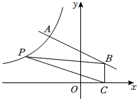

34. （2026•辽宁） 如图，在平面直角坐标系 $xOy$ 中，直线 $y=-\frac{1}{2}x+2$ 与 $y=\frac{k}{x}(x<0)$ 交于点 $A(m, 3)$．
（1）求 $m$、$k$ 的值；
（2）点 $B$ 是直线 $y=-\frac{1}{2}x+2$ 在第一象限内图象上一点，$BC\perp x$ 轴于点 $C$，点 $P$ 为反比例函数 $y=\frac{k}{x}$ 图象上的点，点 $P$ 到 $y$ 轴的距离是点 $B$ 到 $y$ 轴距离的2倍，求 $\triangle PBC$ 面积的最大值及 $P$ 点坐标．

> [!question]- 点击查看答案与解析
> 【答案】（1）$m=-2$，$k=-6$；（2）面积最大值为 $3$，$P\left(-4,\frac{3}{2}\right)$
> 
> 【考点】待定系数法、坐标法求面积与二次函数最值 → [[【初中数学知识点体系-人教版】#27-1 反比例函数]]、[[【初中数学知识点体系-人教版】#23-1 一次函数]]、[[【初中数学知识点体系-人教版】#9-2 坐标方法的简单应用]]
> 
> 【解析】
> （1）$A(m,3)$ 在 $y=-\frac{1}{2}x+2$ 上，$3=-\frac{m}{2}+2$，$m=-2$；$k=(-2)\times3=-6$。
> （2）设 $B\left(u,2-\frac{u}{2}\right)$（$0<u<4$）。$P$ 到 $y$ 轴距离是 $B$ 的 2 倍，$P\left(-2u,\frac{3}{u}\right)$。
> $BC=2-\frac{u}{2}$，$P$ 到直线 $BC$ 的水平距离为 $3u$，$S_{\triangle PBC}=\frac{1}{2}\left(2-\frac{u}{2}\right)3u=3u-\frac{3}{4}u^2$。
> 当 $u=2$ 时面积取最大值 $3$，此时 $P\left(-4,\frac{3}{2}\right)$。
> 
> 【易错点】$P$ 在第二象限，横坐标为负；面积最值化为开口向下的二次函数，注意自变量范围 $0<u<4$。
