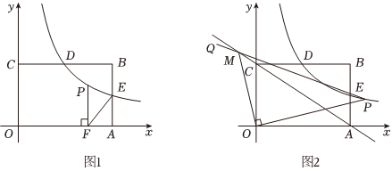

35. （2026•济南） 在平面直角坐标系 $xOy$ 中，矩形 $OABC$ 的边 $OA$ 在 $x$ 轴上，$OC$ 在 $y$ 轴上，点 $B(6, 4)$．反比例函数 $y=\frac{k}{x}$（$x>0$）的图象经过 $BC$ 的中点 $D$，与 $AB$ 交于点 $E$．
（1）求 $k$ 的值；
（2）点 $P$ 是 $y=\frac{k}{x}$（$x>0$）图象上一点．

$①$ 如图1，若点 $P$ 在矩形 $OABC$ 的内部，$PF\perp x$ 轴，垂足为点 $F$，连接 $PE$，$EF$，若 $\triangle PEF$ 的面积为2，求点 $P$ 的坐标；

$②$ 如图2，作直线 $AC$，连接 $OP$，在 $OP$ 上方作 $\angle OPQ=\angle OAC$，过点 $O$ 作 $OP$ 的垂线，交 $PQ$ 于点 $M$，当点 $M$ 落在直线 $AC$ 上时，求点 $P$ 的坐标．

> [!question]- 点击查看答案与解析
> 【答案】（1）$k=12$；（2）① $P(\frac92,\frac83)$；② 待结合原图核验
> 
> 【考点】待定系数法求反比例解析式、坐标法求三角形面积、角构造与相似探究 → [[【初中数学知识点体系-人教版】#27-1 反比例函数]]、[[【初中数学知识点体系-人教版】#9-2 坐标方法的简单应用]]、[[【初中数学知识点体系-人教版】#31-2 相似三角形]]
> 
> 【解析】
> （1）矩形 $OABC$，$B(6,4)$，$C(0,4)$，$BC$ 中点 $D(3,4)$，$k=3\times4=12$。双曲线与 $AB$（$x=6$）交于 $E(6,2)$。
> （2）① 设 $P(p,\frac{12}{p})$，$PF\perp x$ 轴，$F(p,0)$。$PF=\frac{12}{p}$，$E$ 到直线 $PF$ 的水平距离为 $6-p$，$S_{\triangle PEF}=\frac12\cdot\frac{12}{p}\cdot(6-p)=2$，解得 $p=\frac92$，$P(\frac92,\frac83)$，在矩形内部。
> （2）② 本小问涉及 $\angle OPQ=\angle OAC$ 的角构造与 $M$ 落在直线 $AC$ 上的条件，需结合图2点位进一步核验后补全。
> 
> 【易错点】三角形面积以竖直边 $PF$ 为底、水平距离为高；②中垂线 $OM\perp OP$ 与角条件要同时满足，注意 $M$ 在直线 $AC$（含延长线）上的取舍。
