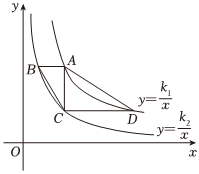

36. （2026•无锡） 如图，点 $A$ 在反比例函数 $y=\frac{k_1}{x}$（$x>0$）的图象上，过 $A$ 分别作 $x$ 轴、$y$ 轴的平行线，与反比例函数 $y=\frac{k_2}{x}$（$x>0$）的图象相交于点 $B$，$C$，过 $C$ 作 $x$ 轴的平行线，与反比例函数 $y=\frac{k_1}{x}$ 的图象相交于点 $D$（其中 $k_{1}$，$k_{2}$ 为常数，且 $k_1>k_2>0$）．
（1）若点 $A(3, 5)$，$AB=2$，则 $k_2=$ ___ ．
（2）若点 $A$ 的横坐标为2，且 $\triangle ABC\sim\triangle CAD$，求 $k_{1}$ 与 $k_{2}$ 之间的数量关系．
（3）延长 $CB$，$DA$ 相交于点 $P$，当点 $A$ 在函数图象上运动时，$\triangle PCD$ 的面积是否为定值？若是，请求出这个定值；若不是，请说明理由．

> [!question]- 点击查看答案与解析
> 【答案】（1）$k_2=5$；（2）$k_1 k_2=16$；（3）是定值，$S_{\triangle PCD}=\frac{k_1(k_1-k_2)}{2k_2}$
> 
> 【考点】反比例函数上点的坐标、相似三角形性质与面积定值探究 → [[【初中数学知识点体系-人教版】#27-1 反比例函数]]、[[【初中数学知识点体系-人教版】#9-2 坐标方法的简单应用]]
> 
> 【解析】
> 设 $A\left(a,\frac{k_1}{a}\right)$，由水平、竖直平行线得 $B\left(\frac{ak_2}{k_1},\frac{k_1}{a}\right)$、$C\left(a,\frac{k_2}{a}\right)$、$D\left(\frac{ak_1}{k_2},\frac{k_2}{a}\right)$。
> （1）$A(3,5)$，$k_1=15$。$AB=3-\frac{3k_2}{15}=2$，解得 $k_2=5$。
> （2）$\triangle ABC$ 与 $\triangle CAD$ 均为直角三角形，$AB=\frac{a(k_1-k_2)}{k_1}$，$AC=\frac{k_1-k_2}{a}$，$CD=\frac{a(k_1-k_2)}{k_2}$。由 $\triangle ABC\sim\triangle CAD$，$\frac{AB}{CA}=\frac{AC}{CD}$，得 $\frac{a^2}{k_1}=\frac{k_2}{a^2}$。$a=2$，故 $k_1 k_2=16$。
> （3）延长 $CB$、$DA$ 交于 $P$，由对称知 $P$ 在 $y$ 轴上，$P\left(0,\frac{k_1+k_2}{a}\right)$。$CD=\frac{a(k_1-k_2)}{k_2}$，$P$ 到 $CD$（水平线 $y=\frac{k_2}{a}$）的高为 $\frac{k_1}{a}$，故 $S_{\triangle PCD}=\frac{1}{2}\cdot\frac{a(k_1-k_2)}{k_2}\cdot\frac{k_1}{a}=\frac{k_1(k_1-k_2)}{2k_2}$，与 $A$ 的位置无关，是定值。
> 
> 【易错点】水平/竖直平行线交点的横纵坐标分别沿用；相似对应边不要写反；定值探究中消去变动的横坐标 $a$ 后再判断。
