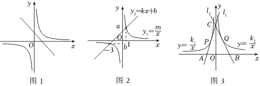

37. （2026•达州） 数学活动：探究一次函数与反比例函数的关系
【定义】当两个函数图象无交点时，称它们为“陌生函数”；当两个函数图象只有一个交点时，称它们为“相连函数”，交点为相连点；当两个函数图象有两个交点时，称它们为“友好函数”，交点为友好点．
根据定义在判定一次函数与反比例函数为何种关系函数时，可用以下两种方法：
【方法一】根据函数表达式画出图象，由图象确定．如图1，因为一次函数与反比例函数图象没有交点，所以它们是“陌生函数”．
【方法二】根据一元二次方程根的判别式确定．如判定 $y=2x-1$ 与 $y=\frac{1}{x}$ 的关系时，由函数表达式得 $2x-1=\frac{1}{x}$，去分母得 $2x^{2}-x-1=0$，因为 $\Delta=9>0$，所以函数图象有两个交点，故它们是“友好函数”．
【问题解决】
（1）对于函数 $①$ $y=-\frac{2}{x}$，$②$ $y=2x$，$③$ $y=-3x+1$．其中 $①$ 与 $②$ 是“ ___ 函数”，$①$ 与 $③$ 是“ ___ 函数”；
（2）若 $y_1=\frac{m}{x}$（$m\neq 0$）与 $y_2=kx+b$（$k\neq 0$）是“友好函数”，如图2，当 $y_1>y_2$ 时，$x$ 的取值范围是 ___ ；若 $y=\frac{n}{x}$（$n\neq 0$）与 $y=2x-6$ 是“相连函数”，则 $n$ 的值为 ___ ；
（3）如图3，过点 $C(0, 6)$ 的直线 $l_1$，$l_2$ 对应的函数分别与 $y=\frac{k_1}{x}(k_1\neq 0, x<0)$，$y=\frac{k_2}{x}(k_2\neq 0, x>0)$ 是“相连函数”，相连点分别为 $P$，$Q$，$l_1$，$l_2$ 与 $x$ 轴分别交于 $A$，$B$ 两点，已知 $AB=6$，$k_1k_2=-18$，求 $k_1^2+k_2^2$ 的值．

> [!question]- 点击查看答案与解析
> 【答案】（1）陌生；友好；（2）$x<-3$ 或 $0<x<a$；$n=-\frac92$；（3）$k_1^2+k_2^2=45$
> 
> 【考点】函数交点与判别式分类、图象法解不等式、双曲线切线与坐标运算 → [[【初中数学知识点体系-人教版】#27-1 反比例函数]]、[[【初中数学知识点体系-人教版】#23-1 一次函数]]
> 
> 【解析】
> （1）①与②：$2x=-\frac2x$，即 $2x^2=-2$，无实数根，无交点，为“陌生函数”。
> ①与③：$-3x+1=-\frac2x$，去分母得 $3x^2-x-2=0$，$\Delta=1+24=25>0$，有两个交点，为“友好函数”。
> （2）两交点横坐标为 $-3$ 与 $a$，由图象（双曲线在直线上方）得 $y_1>y_2$ 的解集为 $x<-3$ 或 $0<x<a$。
> 相连函数：$\frac nx=2x-6$，去分母得 $2x^2-6x-n=0$，只有一个交点故 $\Delta=36+8n=0$，$n=-\frac92$。
> （3）设 $l_1$ 与 $y=\frac{k_1}{x}$ 相切于 $P(p,\frac{k_1}{p})$（$p<0$），$l_2$ 与 $y=\frac{k_2}{x}$ 相切于 $Q(q,\frac{k_2}{q})$（$q>0$）。
> 双曲线 $y=\frac kx$ 在横坐标 $x_0$ 处的切线横截距为 $2x_0$，故 $A(2p,0)$，$B(2q,0)$，$AB=2(q-p)=6$，即 $q-p=3$。
> 切线在 $x=0$ 处的纵坐标为 $\frac{2k}{x_0}$，两切线均过 $C(0,6)$，故 $\frac{2k_1}{p}=6$，$\frac{2k_2}{q}=6$，即 $k_1=3p$，$k_2=3q$。
> 由 $k_1k_2=9pq=-18$，$pq=-2$。联立 $q-p=3$ 得 $(p,q)=(-1,2)$ 或 $(-2,1)$，两种情形均有 $k_1^2+k_2^2=9(p^2+q^2)=45$。
> 
> 【易错点】判别式 $\Delta>0,=0,<0$ 分别对应友好、相连、陌生；解不等式要分象限结合图象，勿漏 $x<0$ 的区间；切线横截距为切点横坐标的两倍，注意 $k_1<0,k_2>0$ 的符号。
