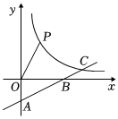

38. （2026•南充） 如图，一次函数图象与 $y$ 轴交于点 $A(0, -3)$，与 $x$ 轴交于点 $B(6, 0)$，与反比例函数图象交于点 $C(m, 1)$．
（1）求一次函数与反比例函数的解析式．
（2）点 $P$ 在反比例函数第一象限图象上，$\angle BOP=\angle OAB$，求点 $P$ 的坐标．

> [!question]- 点击查看答案与解析
> 【答案】（1）一次函数 $y=\frac{1}{2}x-3$，反比例函数 $y=\frac{8}{x}$；（2）$P(2,4)$
> 
> 【考点】待定系数法求解析式、坐标法与锐角三角函数 → [[【初中数学知识点体系-人教版】#27-1 反比例函数]]、[[【初中数学知识点体系-人教版】#23-1 一次函数]]、[[【初中数学知识点体系-人教版】#9-2 坐标方法的简单应用]]
> 
> 【解析】
> （1）直线过 $A(0,-3)$、$B(6,0)$，斜率 $\frac{0+3}{6}=\frac{1}{2}$，解析式为 $y=\frac{1}{2}x-3$。
> $C(m,1)$ 在直线上：$1=\frac{m}{2}-3$，$m=8$，$C(8,1)$；代入双曲线 $k=8\times1=8$，$y=\frac{8}{x}$。
> （2）Rt$\triangle OAB$ 中 $\tan\angle OAB=\frac{OB}{OA}=\frac{6}{3}=2$。由 $\angle BOP=\angle OAB$，$OP$ 与 $x$ 轴夹角的正切为 2。
> 设 $P\left(x,\frac{8}{x}\right)$，$\frac{8}{x^2}=2$，第一象限 $x=2$，$P(2,4)$。
> 
> 【易错点】角度相等转化为直线斜率（正切）相等；注意 $P$ 在第一象限只取正根。
