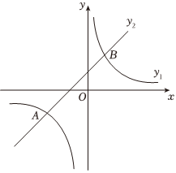

39. （2026•自贡） 如图，反比例函数 $y_1=\frac{m}{x}$ 与一次函数 $y_{2}=x+n$ 的图象相交于 $A$，$B$ 两点，点 $A(-6, -3)$．
（1）求反比例函数的解析式及 $n$ 的值；
（2）请直接写出当 $y_{1}>y_{2}$ 时 $x$ 的取值范围；
（3）点 $P$ 是直线 $y_{2}=x+n$ 上的一个动点，当 $OP\perp AB$ 时，求点 $P$ 的坐标．

> [!question]- 点击查看答案与解析
> 【答案】（1）$y_1=\frac{18}{x}$，$n=3$；（2）$x<-6$ 或 $0<x<3$；（3）$P\left(-\frac{3}{2},\frac{3}{2}\right)$
> 
> 【考点】待定系数法、函数图象比较大小、两直线垂直 → [[【初中数学知识点体系-人教版】#27-1 反比例函数]]、[[【初中数学知识点体系-人教版】#23-1 一次函数]]
> 
> 【解析】
> （1）$A(-6,-3)$ 在 $y_1=\frac{m}{x}$ 上，$m=18$。代入 $y_2=x+n$：$-3=-6+n$，$n=3$。
> （2）联立 $\frac{18}{x}=x+3$，另一交点 $B(3,6)$；双曲线在直线上方的区间为 $x<-6$ 或 $0<x<3$。
> （3）$AB$ 斜率为 1，$OP\perp AB$ 故 $OP$ 斜率为 $-1$，$y=-x$；与 $y=x+3$ 联立得 $P\left(-\frac{3}{2},\frac{3}{2}\right)$。
> 
> 【易错点】比较大小要分象限看图象上下；垂直两直线斜率乘积为 $-1$。
