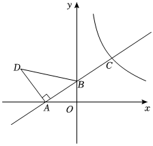

40. （2026•广元） 如图，在平面直角坐标系 $xOy$ 中，一次函数 $y=\frac{1}{2}x+b$ 的图象与 $x$ 轴，$y$ 轴分别交于 $A$，$B$ 两点，与函数 $y=\frac{4}{x}$（$x>0$）的图象交于点 $C(a, 2)$．
（1）求 $a$，$b$ 的值；
（2）将线段 $AB$ 绕点 $A$ 逆时针旋转 $90^\circ$ 到 $AD$，连接 $BD$，将 $\triangle ABD$ 沿直线 $AB$ 平移，当点 $D$ 的对应点 $E$ 恰好落在函数 $y=\frac{4}{x}$（$x>0$）的图象上时，求点 $E$ 的坐标．

> [!question]- 点击查看答案与解析
> 【答案】（1）$a=2$，$b=1$；（2）$E(1,4)$
> 
> 【考点】待定系数法、旋转坐标变换与平移 → [[【初中数学知识点体系-人教版】#27-1 反比例函数]]、[[【初中数学知识点体系-人教版】#23-1 一次函数]]、[[【初中数学知识点体系-人教版】#28-1 图形的旋转]]、[[【初中数学知识点体系-人教版】#9-2 坐标方法的简单应用]]
> 
> 【解析】
> （1）$C(a,2)$ 在 $y=\frac{4}{x}$ 上，$a=2$，$C(2,2)$；代入 $y=\frac{1}{2}x+b$ 得 $b=1$。
> 直线 $y=\frac{1}{2}x+1$ 交 $x$ 轴于 $A(-2,0)$，交 $y$ 轴于 $B(0,1)$。
> （2）$\overrightarrow{AB}=(2,1)$，绕 $A$ 逆时针旋转 $90^\circ$ 得 $(-1,2)$，$D=A+(-1,2)=(-3,2)$。
> 沿 $AB$ 方向平移，设平移向量为 $t(2,1)$，$E=(-3+2t,2+t)$。代入 $y=\frac{4}{x}$：$(-3+2t)(2+t)=4$，解得 $t=2$（另一根对应 $x<0$，舍去），$E(1,4)$。
> 
> 【易错点】旋转 $90^\circ$ 时向量 $(u,v)$ 变为 $(-v,u)$；平移方向与 $AB$ 平行；双曲线限定 $x>0$，需舍去另一交点。
