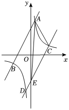

41. （2026•眉山） 如图，一次函数 $y=kx+b$ 的图象与反比例函数 $y=\frac{8}{x}$ 的图象交于 $A(m, 8)$，$B(-4, n)$ 两点．
（1）求一次函数的表达式；
（2）观察图象，直接写出不等式 $kx+b\geq\frac{8}{x}$ 的解集；
（3）将直线 $AB$ 向下平移 12 个单位后交反比例函数的图象于 $C$，$D$ 两点，交 $y$ 轴于点 $E$，连接 $AC$，$AE$，求 $\triangle ACE$ 的面积．

> [!question]- 点击查看答案与解析
> 【答案】（1）$y=2x+6$；（2）$-4\le x<0$ 或 $x\ge1$；（3）$S_{\triangle ACE}=24$
> 
> 【考点】待定系数法、不等式解集、平移与坐标法求面积 → [[【初中数学知识点体系-人教版】#27-1 反比例函数]]、[[【初中数学知识点体系-人教版】#23-1 一次函数]]、[[【初中数学知识点体系-人教版】#9-2 坐标方法的简单应用]]
> 
> 【解析】
> （1）$A(m,8)$ 在 $y=\frac{8}{x}$ 上，$m=1$，$A(1,8)$；$B(-4,n)$，$n=-2$，$B(-4,-2)$。直线斜率 $2$，$y=2x+6$。
> （2）直线在双曲线上方（$kx+b\ge\frac{8}{x}$）的解集为 $-4\le x<0$ 或 $x\ge1$。
> （3）直线下移 12 个单位得 $y=2x-6$，交 $y$ 轴于 $E(0,-6)$；联立 $2x-6=\frac{8}{x}$ 得 $C(4,2)$、$D(-1,-8)$。
> $S_{\triangle ACE}=\frac{1}{2}|1(2+6)+4(-6-8)|=24$。
> 
> 【易错点】平移后截距改变、斜率不变；面积用行列式，注意 $C$ 为第一象限交点。
