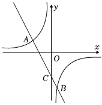

42. （2026•遂宁） 如图，一次函数 $y_1=kx+b$（$k\neq 0$）的图象与反比例函数 $y_2=\frac{m}{x}$（$m\neq 0$）的图象交于 $A(-3, 2)$、$B(a, -6)$ 两点，与 $y$ 轴交于点 $C$．
（1）求一次函数与反比例函数的表达式；
（2）根据图象，直接写出 $y_{1}>y_{2}$ 时 $x$ 的取值范围；
（3）将一次函数 $y_1=kx+b$ 的图象向上平移 5 个单位长度后，与 $x$ 轴下方的反比例函数 $y_2=\frac{m}{x}$ 图象交于点 $P$，求 $\triangle ACP$ 的面积．

> [!question]- 点击查看答案与解析
> 【答案】（1）反比例函数 $y=-\frac{6}{x}$，一次函数 $y=-2x-4$；（2）$-3<x<0$ 或 $x>1$；（3）$S_{\triangle ACP}=\frac{15}{2}$
> 
> 【考点】待定系数法、图象比较大小、平移与坐标法求面积 → [[【初中数学知识点体系-人教版】#27-1 反比例函数]]、[[【初中数学知识点体系-人教版】#23-1 一次函数]]、[[【初中数学知识点体系-人教版】#9-2 坐标方法的简单应用]]
> 
> 【解析】
> （1）$A(-3,2)$ 在 $y_2=\frac{m}{x}$ 上，$m=-6$。$B(a,-6)$：$-6=\frac{-6}{a}$，$a=1$，$B(1,-6)$。直线斜率 $\frac{-6-2}{1+3}=-2$，$y=-2x-4$，$C(0,-4)$。
> （2）双曲线在直线上方的区间为 $-3<x<0$ 或 $x>1$。
> （3）直线上移 5 个单位得 $y=-2x+1$；与 $x$ 轴下方分支联立 $-2x+1=\frac{-6}{x}$，解得 $P(2,-3)$。
> $S_{\triangle ACP}=\frac{1}{2}|x_A(y_C-y_P)+x_P(y_A-y_C)|=\frac{1}{2}|-3(-4+3)+2(2+4)|=\frac{15}{2}$。
> 
> 【易错点】平移只改变截距、斜率不变；求面积用行列式并取绝对值，注意区分上下分支。
