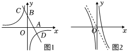

43. （2026•广安） 如图1，在平面直角坐标系中，一次函数 $y=kx+4$（$k$ 为常数，$k\neq 0$）的图象与 $x$ 轴，$y$ 轴分别交于 $A$，$B$ 两点，与反比例函数 $y=\frac{m}{x}$（$m$ 为常数，$m\neq 0$）在第二，四象限分别交于 $C$，$D$ 两点，点 $D(3, b)$，$OB=2OA$．
（1）求一次函数和反比例函数的解析式；
（2）点 $P$ 在坐标轴上，以点 $O$，$D$，$P$ 为顶点的等腰三角形有 ___ 个，当点 $P$ 在 $x$ 轴负半轴时，求等腰三角形 $ODP$ 的面积；
（3）如图2，已知函数 $y=kx-\frac{m}{x}$ 的大致图象，请结合图象直接写出该函数的两条性质．

> [!question]- 点击查看答案与解析
> 【答案】（1）一次函数 $y=-2x+4$，反比例函数 $y=-\frac{6}{x}$；（2）$8$ 个，$S_{\triangle ODP}=\sqrt{13}$；（3）① 图象关于原点对称；② 在每个象限内 $y$ 随 $x$ 的增大而减小（与坐标轴无交点）
> 
> 【考点】待定系数法、等腰三角形分类讨论与函数图象性质 → [[【初中数学知识点体系-人教版】#27-1 反比例函数]]、[[【初中数学知识点体系-人教版】#23-1 一次函数]]、[[【初中数学知识点体系-人教版】#9-2 坐标方法的简单应用]]
> 
> 【解析】
> （1）$B(0,4)$，$OB=4$。由 $OB=2OA$ 得 $OA=2$，$A(2,0)$。代入 $y=kx+4$ 得 $k=-2$，$y=-2x+4$。
> $D(3,b)$，$b=-2\times3+4=-2$，$D(3,-2)$；$m=3\times(-2)=-6$，$y=-\frac{6}{x}$。
> （2）$OD=\sqrt{13}$。设 $P$ 在 $x$ 轴上 $P(p,0)$：$OD=OP$ 得 $p=\pm\sqrt{13}$；$OD=DP$ 得 $p=6$（$p=0$ 与 $O$ 重合，舍去）；$DP=OP$ 得 $p=\frac{13}{6}$，共 4 个。
> 设 $P$ 在 $y$ 轴上 $P(0,q)$：$OD=OP$ 得 $q=\pm\sqrt{13}$；$OD=DP$ 得 $q=-4$（$q=0$ 舍去）；$DP=OP$ 得 $q=-\frac{13}{4}$，共 4 个。合计 8 个。
> $P$ 在 $x$ 轴负半轴时 $P(-\sqrt{13},0)$，$OP=\sqrt{13}$，高为 $|y_D|=2$，$S_{\triangle ODP}=\frac{1}{2}\times\sqrt{13}\times2=\sqrt{13}$。
> （3）$y=kx-\frac{m}{x}=-2x+\frac{6}{x}$ 为奇函数，图象关于原点对称；在每个象限内 $y$ 随 $x$ 增大而减小，且与坐标轴无交点。
> 
> 【易错点】等腰三角形要按哪两条边相等分三类（$OD=OP$、$OD=DP$、$DP=OP$），并排除与 $O$ 重合的退化情形；坐标轴上的点要分别讨论。
