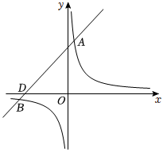

44. （2026•巴中） 如图，在平面直角坐标系中，直线 $y=x+8$ 与双曲线 $y=\frac{k}{x}$（$k\neq 0$）交于 $A(1, a)$、$B$ 两点，与 $x$ 轴交于点 $D$．
（1）求反比例函数的表达式及点 $B$ 的坐标．
（2）直接写出不等式 $\frac{k}{x}<x+8$ 的解集．
（3）若点 $P$ 为 $x$ 轴上的动点，当 $\triangle ADP$ 为直角三角形时，求点 $P$ 的坐标．

> [!question]- 点击查看答案与解析
> 【答案】（1）$y=\frac{9}{x}$，$B(-9,-1)$；（2）$-9<x<0$ 或 $x>1$；（3）$P(1,0)$ 或 $P(10,0)$
> 
> 【考点】待定系数法、不等式解集与直角三角形分类讨论 → [[【初中数学知识点体系-人教版】#27-1 反比例函数]]、[[【初中数学知识点体系-人教版】#23-1 一次函数]]、[[【初中数学知识点体系-人教版】#9-2 坐标方法的简单应用]]
> 
> 【解析】
> （1）$A(1,a)$ 在 $y=x+8$ 上，$a=9$；$k=1\times9=9$。联立 $x+8=\frac{9}{x}$，得 $B(-9,-1)$，$D(-8,0)$。
> （2）$\frac{9}{x}<x+8$（双曲线在直线下方）的解集为 $-9<x<0$ 或 $x>1$。
> （3）设 $P(p,0)$。直角顶点在 $P$：$PA\perp PD$，$PD$ 水平，故 $PA$ 竖直，$p=1$，$P(1,0)$。
> 直角顶点在 $A$：$\overrightarrow{AD}\cdot\overrightarrow{AP}=0$，$(-9,-9)\cdot(p-1,-9)=0$，得 $p=10$，$P(10,0)$。直角顶点在 $D$ 时与 $D$ 重合，舍去。
> 
> 【易错点】直角三角形要按直角顶点分三类讨论；在 $x$ 轴上的两点连线为水平方向。
