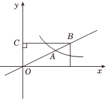

45. （2026•凉山州） 如图，在平面直角坐标系中，正比例函数 $y=\frac{1}{2}x$ 的图象与反比例函数 $y=\frac{k}{x}$（$x>0$）的图象交于点 $A(m, 2)$，在射线 $OA$ 上取一点 $B$，使得 $OB:OA=3:2$，过点 $B$ 作 $BC\perp y$ 轴于点 $C$．
（1）求反比例函数的解析式；
（2）直接写出点 $B$ 的坐标 ___ ；
（3）在 $x$ 轴上存在一点 $P$，使 $PA+PC$ 的值最小，求点 $P$ 坐标．

> [!question]- 点击查看答案与解析
> 【答案】（1）$y=\frac{8}{x}$；（2）$B(6,3)$；（3）$P\left(\frac{12}{5},0\right)$
> 
> 【考点】待定系数法、线段比例与轴对称最短路径 → [[【初中数学知识点体系-人教版】#27-1 反比例函数]]、[[【初中数学知识点体系-人教版】#9-2 坐标方法的简单应用]]
> 
> 【解析】
> （1）$A(m,2)$ 在 $y=\frac{1}{2}x$ 上，$m=4$，$A(4,2)$；$k=4\times2=8$，$y=\frac{8}{x}$。
> （2）$OB:OA=3:2$，$B=\frac{3}{2}A=(6,3)$。
> （3）$BC\perp y$ 轴，$C(0,3)$。作 $C$ 关于 $x$ 轴的对称点 $C'(0,-3)$，直线 $AC'$ 与 $x$ 轴交点即所求 $P$。
> 直线 $AC'$ 斜率 $\frac{2+3}{4}=\frac{5}{4}$，$y=\frac{5}{4}x-3$，令 $y=0$ 得 $x=\frac{12}{5}$，$P\left(\frac{12}{5},0\right)$。
> 
> 【易错点】最短路径用对称转化为两点间线段；分点坐标按比例放大，方向沿射线 $OA$。
