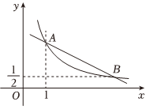

46. （2026•盐城） 小明利用数学画图软件，进行了如下操作：
（Ⅰ）生成反比例函数 $y=\frac{2}{x}$（$x>0$）的图象；
（Ⅱ）过点 $(1, 0)$ 生成 $x$ 轴的垂线，过点 $(0, \frac{1}{2})$ 生成 $y$ 轴的垂线，分别交反比例函数的图象于点 $A$，$B$，生成直线 $AB$．
所得图形如图所示，根据信息，解答下列问题．
（1）求 $A$，$B$ 两点的坐标，以及直线 $AB$ 的函数表达式 $y=kx+b$。
（2）在（1）的基础上，当 $x$ 在什么范围内时，反比例函数 $y=\frac{2}{x}$（$x>0$）的值大于一次函数 $y=kx+b$ 的值？（直接写出结果）

> [!question]- 点击查看答案与解析
> 【答案】（1）$A(1,2)$，$B\left(4,\frac{1}{2}\right)$，直线 $y=-\frac{1}{2}x+\frac{5}{2}$；（2）$1<x<4$
> 
> 【考点】待定系数法求直线解析式、图象比较大小 → [[【初中数学知识点体系-人教版】#27-1 反比例函数]]、[[【初中数学知识点体系-人教版】#23-1 一次函数]]
> 
> 【解析】
> （1）$x=1$ 代入 $y=\frac{2}{x}$ 得 $A(1,2)$；$y=\frac{1}{2}$ 代入得 $x=4$，$B\left(4,\frac{1}{2}\right)$。
> 直线斜率 $\frac{\frac{1}{2}-2}{4-1}=-\frac{1}{2}$，$y-2=-\frac{1}{2}(x-1)$，即 $y=-\frac{1}{2}x+\frac{5}{2}$。
> （2）两交点横坐标为 1、4，双曲线值大于一次函数值的区间为 $1<x<4$。
> 
> 【易错点】竖线、横线与双曲线交点的横/纵坐标直接由双曲线解析式读出；比较大小看两交点之间。
