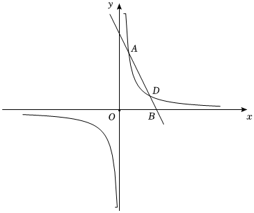

47. （2026•大庆） 如图，在平面直角坐标系中，$O$ 为坐标原点，直线 $y=-x+6$ 与反比例函数 $y=\frac{m}{x}$（$m>0$）的图象交于点 $D$ 及点 $A(a, 4)$，与 $x$ 轴交于点 $B$．
（1）求 $m$ 的值；
（2）若直线 $AO$ 与反比例函数 $y=\frac{m}{x}$（$m>0$）的图象在第三象限交于点 $C$，求点 $C$ 的坐标及 $\triangle ABC$ 的面积；
（3）在第三象限内的反比例函数 $y=\frac{m}{x}$（$m>0$）的图象上，是否存在点 $E$，使得 $\triangle ADE$ 为直角三角形，若存在，请直接写出满足条件的所有点 $E$ 的坐标；若不存在，请说明理由．

> [!question]- 点击查看答案与解析
> 【答案】（1）$m=8$；（2）$C(-2,-4)$，$S_{\triangle ABC}=24$；（3）$E(-4,-2)$ 或 $E(-2,-4)$
> 
> 【考点】待定系数法、中心对称、坐标法求面积与直角三角形分类讨论 → [[【初中数学知识点体系-人教版】#27-1 反比例函数]]、[[【初中数学知识点体系-人教版】#23-1 一次函数]]、[[【初中数学知识点体系-人教版】#9-2 坐标方法的简单应用]]
> 
> 【解析】
> （1）$A(a,4)$ 在 $y=-x+6$ 上，$a=2$，$A(2,4)$，$m=2\times4=8$。
> （2）直线 $AO$ 为 $y=2x$，与 $y=\frac{8}{x}$ 在第三象限交于 $C(-2,-4)$。$B(6,0)$，$S_{\triangle ABC}=\frac{1}{2}|2(0+4)+6(-4-4)-2(4-0)|=24$。
> （3）设 $E\left(e,\frac{8}{e}\right)$（$e<0$）。直角顶点在 $A$：$\overrightarrow{AD}\cdot\overrightarrow{AE}=0$，$D(4,2)$，解得 $E(-4,-2)$。
> 直角顶点在 $D$：$\overrightarrow{DA}\cdot\overrightarrow{DE}=0$，解得 $E(-2,-4)$。直角顶点在 $E$ 时方程的解为 $e=2$ 或 $4$，不在第三象限，舍去。
> 
> 【易错点】直角三角形要按直角顶点分三类；第三象限分支只取 $x<0$ 的解，注意排除与 $A$、$D$ 重合的点。
