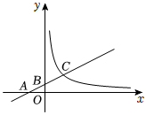

48. （2026•常州） 如图，在平面直角坐标系 $xOy$ 中，一次函数 $y=kx+b$ 的图象分别与 $x$ 轴、$y$ 轴相交于点 $A$，$B$，与反比例函数 $y=\frac{m}{x}$（$m>0$，$x>0$）的图象相交于点 $C$．已知点 $B$，$C$ 的坐标分别为 $(0, 1)$，$(2, 2)$．
（1）求一次函数、反比例函数的表达式．
（2）点 $D$ 在反比例函数 $y=\frac{m}{x}$（$m>0$，$x>0$）的图象上，且点 $D$ 与点 $C$ 不重合．作射线 $CD$，交坐标轴于点 $M$，连接 $OC$，$OD$．若 $S_{\triangle OCM}=4S_{\triangle ODM}$，求点 $D$ 的坐标．

> [!question]- 点击查看答案与解析
> 【答案】（1）一次函数 $y=\frac12x+1$，反比例函数 $y=\frac4x$；（2）$D(8,\frac12)$ 或 $D(\frac12,8)$
> 
> 【考点】待定系数法求解析式、共线三角形面积比与坐标运算 → [[【初中数学知识点体系-人教版】#27-1 反比例函数]]、[[【初中数学知识点体系-人教版】#23-1 一次函数]]
> 
> 【解析】
> （1）直线过 $B(0,1)$、$C(2,2)$，斜率 $k=\frac{2-1}{2}=\frac12$，故 $y=\frac12x+1$。$m=2\times2=4$，故 $y=\frac4x$。
> （2）$C,D,M$ 共线，$\triangle OCM$ 与 $\triangle ODM$ 以 $O$ 到直线 $CM$ 的同一距离为高，面积比等于底之比 $\frac{CM}{DM}=4$，即 $CD=3DM$，$D$ 在线段 $CM$ 上且 $DM:MC=1:4$。
> 当 $M$ 在 $x$ 轴上，设 $M(m,0)$，由分点 $D=\frac14C+\frac34M$ 得 $D_y=\frac12$，代入 $y=\frac4x$ 得 $D_x=8$，再由 $D_x=\frac{2+3m}{4}$ 得 $m=10$，故 $D(8,\frac12)$。
> 当 $M$ 在 $y$ 轴上，同理 $D_x=\frac12$，$D_y=8$，$M(0,10)$，故 $D(\frac12,8)$。两种情形面积比均为 $4:1$，均符合题意。
> 
> 【易错点】面积比 $CM:DM=4:1$ 不要与 $CD:DM$ 混淆；射线 $CD$ 交 $x$ 轴、$y$ 轴各有一种对称解，注意分类不要漏解。
