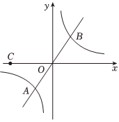

49. （2026•镇江） 如图，在平面直角坐标系中，$O$ 为坐标原点，正比例函数 $y=\frac{3}{2}x$ 与反比例函数 $y=\frac{k}{x}$（$k\neq 0$）的图象交于 $A(-2, m)$，$B$ 两点，$x$ 轴上的点 $C(-5, 0)$．
（1）求点 $A$，$B$ 的坐标以及反比例函数 $y=\frac{k}{x}$（$k\neq 0$）的表达式．
（2）点 $D$ 在 $x$ 轴上，当四边形 $ACBD$ 为平行四边形时，点 $D$ 的坐标为 ___ ．

> [!question]- 点击查看答案与解析
> 【答案】（1）$A(-2,-3)$，$B(2,3)$，$y=\frac{6}{x}$；（2）$D(5,0)$
> 
> 【考点】待定系数法、中心对称与平行四边形性质 → [[【初中数学知识点体系-人教版】#27-1 反比例函数]]、[[【初中数学知识点体系-人教版】#9-2 坐标方法的简单应用]]
> 
> 【解析】
> （1）$A(-2,m)$ 在 $y=\frac{3}{2}x$ 上，$m=-3$，$A(-2,-3)$；$k=(-2)(-3)=6$。双曲线与过原点直线关于原点对称，$B(2,3)$。
> （2）平行四边形 $ACBD$ 的对角线 $AB$、$CD$ 互相平分，$AB$ 中点为原点，故 $CD$ 中点也为原点。$C(-5,0)$，得 $D(5,0)$。
> 
> 【易错点】过原点的直线与双曲线两交点关于原点对称；平行四边形对角线中点重合。
