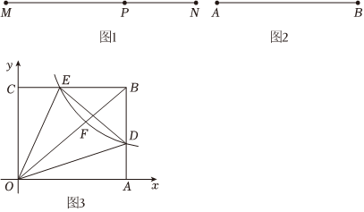

50. （2025•广东） 定义：把某线段一分为二的点，当整体线段比大线段等于大线段比小线段时，则称此线段被分为中外比，这个点称为中外比点．
（1）如图1，点 $P$ 是线段 $MN$ 的中外比点，$MP>PN$，$MN=2$，求 $PN$ 的长．
（2）如图2，用无刻度的直尺和圆规求作一点 $C$ 把线段 $AB$ 分为中外比．（保留作图痕迹，不写作法）
（3）如图3，动点 $B$ 在第一象限内，反比例函数 $y=\frac{k}{x}$（$k>0$，$x>0$）的图象分别与矩形 $OABC$ 的边 $AB$，$BC$ 相交于点 $D$，$E$，与对角线 $OB$ 相交于点 $F$．当 $\triangle ODE$ 是等腰直角三角形时，探究点 $D$，$E$，$F$ 是否分别为 $AB$，$BC$，$OB$ 的中外比点，并证明．

> [!question]- 点击查看答案与解析
> 【答案】（1）$PN=3-\sqrt5$；（2）按黄金分割尺规作图留痕；（3）待结合等腰直角条件核验证明
> 
> 【考点】中外比（黄金分割）定义与方程、尺规作图、反比例函数与坐标几何证明 → [[【初中数学知识点体系-人教版】#27-1 反比例函数]]、[[【初中数学知识点体系-人教版】#31-1 图形的相似]]、[[【初中数学知识点体系-人教版】#20-1 勾股定理]]
> 
> 【解析】
> （1）设 $MP=x$，$PN=2-x$，$MP>PN$。由中外比定义 $\frac{MN}{MP}=\frac{MP}{PN}$，$\frac2x=\frac{x}{2-x}$，$x^2+2x-4=0$，$x=\sqrt5-1$，故 $PN=2-(\sqrt5-1)=3-\sqrt5$。
> （2）尺规作法：过点 $B$ 作 $AB$ 的垂线，截取 $BD=\frac12AB$，连接 $AD$；在 $AD$ 上截取 $DE=DB$，再在 $AB$ 上截取 $AC=AE$，点 $C$ 即为 $AB$ 的中外比点（保留作图痕迹）。
> （3）本小问需在 $\triangle ODE$ 为等腰直角三角形的条件下，用坐标法推导 $D,E,F$ 满足 $\frac{AB}{AD}=\frac{AD}{DB}$ 等比例关系，待结合图3点位核验后补全证明。
> 
> 【易错点】中外比是“整体:大=大:小”，列方程时分清大线段与小线段；黄金分割较长段为整体的 $\frac{\sqrt5-1}{2}$，勿与较短段混淆。
