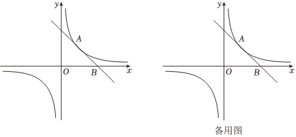

51. （2025•成都） 如图，在平面直角坐标系 $xOy$ 中，直线 $y=-x+b$ 与反比例函数 $y=\frac{k}{x}$ 的图象的一个交点为 $A(a, 2)$，与 $x$ 轴的交点为 $B(3, 0)$．
（1）求 $k$ 的值；
（2）直线 $AO$ 与反比例函数的图象在第三象限交于点 $C$，点 $D$ 在反比例函数的图象上，若 $\angle ACD=90^\circ$，求直线 $AD$ 的函数表达式；
（3）$P$ 为 $x$ 轴上一点，直线 $AP$ 交反比例函数的图象于点 $E$（异于 $A$），连接 $BE$，若 $\triangle BEP$ 的面积为2，求点 $E$ 的坐标．

> [!question]- 点击查看答案与解析
> 【答案】（1）$k=2$；（2）$y=\frac{3}{5}x+\frac{7}{5}$；（3）$E\left(\frac{2}{3},3\right)$ 或 $E(-2,-1)$
> 
> 【考点】待定系数法、垂直条件、坐标法求面积与分类讨论 → [[【初中数学知识点体系-人教版】#27-1 反比例函数]]、[[【初中数学知识点体系-人教版】#23-1 一次函数]]、[[【初中数学知识点体系-人教版】#9-2 坐标方法的简单应用]]
> 
> 【解析】
> （1）$B(3,0)$ 在 $y=-x+b$ 上，$b=3$；$A(a,2)$ 代入得 $a=1$，$A(1,2)$，$k=1\times2=2$。
> （2）直线 $AO$ 过原点与 $A$，第三象限交点 $C(-1,-2)$。设 $D\left(d,\frac{2}{d}\right)$，由 $\angle ACD=90^\circ$，$\overrightarrow{CA}\cdot\overrightarrow{CD}=0$：$2(d+1)+4\left(\frac{2}{d}+2\right)=0$，解得 $d=-4$（$d=-1$ 与 $C$ 重合，舍去），$D(-4,-1)$。
> 直线 $AD$ 斜率 $\frac{3}{5}$，$y=\frac{3}{5}x+\frac{7}{5}$。
> （3）设 $E\left(e,\frac{2}{e}\right)$，直线 $AE$ 与 $x$ 轴交于 $P(1+e,0)$。$B(3,0)$，$S_{\triangle BEP}=\frac{1}{2}|e-2|\cdot\left|\frac{2}{e}\right|=2$，解得 $e=\frac{2}{3}$ 或 $e=-2$。
> 
> 【易错点】垂直用向量点积为 0；面积以 $x$ 轴上的 $BP$ 为底、$E$ 的纵坐标绝对值为高；方程两根都要检验是否异于 $A$。
