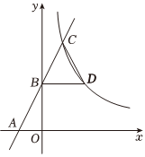

52. （2025•苏州） 如图，一次函数 $y=2x+4$ 的图象与 $x$ 轴，$y$ 轴分别交于 $A$，$B$ 两点，与反比例函数 $y=\frac{k}{x}$（$k\neq 0$，$x>0$）的图象交于点 $C$，过点 $B$ 作 $x$ 轴的平行线与反比例函数 $y=\frac{k}{x}$（$k\neq 0$，$x>0$）的图象交于点 $D$．连接 $CD$．
（1）求 $A$，$B$ 两点的坐标；
（2）若 $\triangle BCD$ 是以 $BD$ 为底边的等腰三角形，求 $k$ 的值．

> [!question]- 点击查看答案与解析
> 【答案】（1）$A(-2,0)$，$B(0,4)$；（2）$k=16$
> 
> 【考点】一次函数交点坐标、等腰三角形性质与待定系数法 → [[【初中数学知识点体系-人教版】#27-1 反比例函数]]、[[【初中数学知识点体系-人教版】#23-1 一次函数]]、[[【初中数学知识点体系-人教版】#9-2 坐标方法的简单应用]]
> 
> 【解析】
> （1）$y=2x+4$ 令 $y=0$ 得 $A(-2,0)$，令 $x=0$ 得 $B(0,4)$。
> （2）$BD$ 为水平线段，$D\left(\frac{k}{4},4\right)$。$\triangle BCD$ 以 $BD$ 为底边等腰，故 $CB=CD$，$C$ 在 $BD$ 的竖直平分线上，$x_C=\frac{k}{8}$。
> $C$ 在直线上，$y_C=2\cdot\frac{k}{8}+4=\frac{k}{4}+4$；代入双曲线 $x_C y_C=k$，解得 $k=16$。
> 
> 【易错点】等腰三角形以 $BD$ 为底 ⇒ 顶点 $C$ 在底边的垂直平分线上；水平线的垂直平分线为竖直线。
