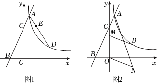

53. （2025•济南） 一次函数 $y=2x+4$ 的图象与反比例函数 $y=\frac{k}{x}(x>0)$ 的图象交于点 $A(m, 6)$，与 $x$ 轴交于点 $B$，与 $y$ 轴交于点 $C$．
（1）求 $m$，$k$ 的值．
（2）$D$ 为反比例函数图象上的一点且横坐标大于 $m$．
$①$ 如图1，若点 $D$ 的横坐标为4，连接 $AD$，$E$ 为线段 $AD$ 上一点，且 $\frac{AE}{ED}=\frac{1}{2}$，求点 $E$ 的坐标；
$②$ 如图2，$M$ 为线段 $OC$ 上一点，且 $CM=1$，四边形 $OMDN$ 是平行四边形，连接 $AN$，若 $\angle BAN=45^\circ$，求点 $D$ 的坐标．

> [!question]- 点击查看答案与解析
> 【答案】（1）$m=1$，$k=6$；（2）① $E(2,5)$；② $D(2+\sqrt2,6-3\sqrt2)$
> 
> 【考点】待定系数法、线段定比分点、平行四边形顶点坐标、$45^\circ$ 角与向量夹角 → [[【初中数学知识点体系-人教版】#27-1 反比例函数]]、[[【初中数学知识点体系-人教版】#23-1 一次函数]]、[[【初中数学知识点体系-人教版】#21-1 平行四边形]]、[[【初中数学知识点体系-人教版】#31-2 相似三角形]]
> 
> 【解析】
> （1）$A(m,6)$ 在 $y=2x+4$ 上，$6=2m+4$，$m=1$，$A(1,6)$，$k=1\times6=6$。$B(-2,0)$，$C(0,4)$。
> （2）① $D$ 横坐标为 $4$，$D(4,3)$。由 $AE:ED=1:2$，$E=\frac{2A+D}{3}=(2,5)$。
> ② $M$ 在 $OC$ 上且 $CM=1$，$M(0,3)$。平行四边形 $OMDN$ 中 $\overrightarrow{ON}=\overrightarrow{OD}-\overrightarrow{OM}$，设 $D(x,\frac6x)$，则 $N(x,\frac6x-3)$。
> $\overrightarrow{AB}=(-3,-6)$，$\overrightarrow{AN}=(x-1,\frac6x-9)$。由 $\angle BAN=45^\circ$，$\frac{|\overrightarrow{AB}\times\overrightarrow{AN}|}{\overrightarrow{AB}\cdot\overrightarrow{AN}}=1$。
> 解得 $x^2-4x+2=0$，$x=2\pm\sqrt2$；另一组方程正根 $x=-13+\sqrt{187}<1$，且对应点积为负、夹角为钝角，舍去。由 $x>m=1$ 取 $x=2+\sqrt2$，$D(2+\sqrt2,6-3\sqrt2)$。
> 
> 【易错点】平行四边形顶点按 $O-M-D-N$ 顺序，$N$ 的坐标是 $D-M$ 而非 $D+M$；$45^\circ$ 角对应点积为正，需排除夹角为钝角的根，并结合 $x>1$ 取舍。
