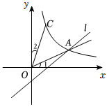

54. （2025•江西） 如图，直线 $l$：$y=\frac{2}{3}x+m$ 与反比例函数 $y=\frac{k}{x}$（$k\neq 0$）的图象交于点 $A(6, 2)$．
（1）求一次函数和反比例函数解析式；
（2）将直线 $l$ 向上平移，在 $x$ 轴上方与反比例函数图象交于点 $C$，连接 $OA$，$OC$，当 $\angle 1=\angle 2$ 时，求点 $C$ 的坐标及直线 $l$ 平移的距离．

> [!question]- 点击查看答案与解析
> 【答案】（1）一次函数 $y=\frac{2}{3}x-2$，反比例函数 $y=\frac{12}{x}$；（2）$C(4,3)$，平移距离为 $\frac{7}{3}$
> 
> 【考点】待定系数法、角的倍半关系与直线平移 → [[【初中数学知识点体系-人教版】#27-1 反比例函数]]、[[【初中数学知识点体系-人教版】#23-1 一次函数]]、[[【初中数学知识点体系-人教版】#9-2 坐标方法的简单应用]]
> 
> 【解析】
> （1）$A(6,2)$ 在 $y=\frac{k}{x}$ 上，$k=12$；代入 $y=\frac{2}{3}x+m$ 得 $m=-2$。
> （2）设 $OA$ 与 $x$ 轴夹角为 $\alpha$，$\tan\alpha=\frac{2}{6}=\frac{1}{3}$。由 $\angle1=\angle2$，$OC$ 方向角为 $2\alpha$，$\tan2\alpha=\frac{2\tan\alpha}{1-\tan^2\alpha}=\frac{3}{4}$。
> $C$ 在射线 $y=\frac{3}{4}x$ 与 $y=\frac{12}{x}$ 上，解得 $C(4,3)$。
> 平移后直线斜率不变，过 $C$：$y=\frac{2}{3}x+\frac{1}{3}$；与原直线 $y=\frac{2}{3}x-2$ 比较，竖直平移距离为 $\frac{1}{3}-(-2)=\frac{7}{3}$。
> 
> 【易错点】角平分线条件转化为方向角加倍，用二倍角正切公式；平移不改变斜率，平移量看截距之差。
