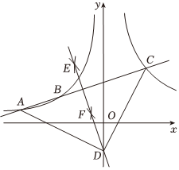

55. （2025•淄博） 如图，反比例函数 $y=\frac{-6}{x}$（$x<0$）和 $y=\frac{12}{x}$（$x>0$）的图象分别与直线 $y=kx+b$ 依次相交于 $A(m, 1)$，$B$，$C(3, n)$ 三点．
（1）求出直线 $AC$ 对应的函数表达式；
（2）分别以点 $A$，$C$ 为圆心，以大于 $\frac{1}{2}AC$ 的长度为半径作弧，两弧相交于点 $E$ 和点 $F$，直线 $EF$ 交 $y$ 轴于点 $D$，连接 $AD$、$CD$．试判断 $\triangle ACD$ 的形状，并说明理由；
（3）请直接写出关于 $x$ 的不等式 $kx+b<\frac{-6}{x}$ 的解集．

> [!question]- 点击查看答案与解析
> 【答案】（1）$y=\frac{1}{3}x+3$；（2）$\triangle ACD$ 是等腰直角三角形（$D$ 为直角顶点）；（3）$x<-6$
> 
> 【考点】待定系数法、垂直平分线与勾股定理逆定理、不等式解集 → [[【初中数学知识点体系-人教版】#27-1 反比例函数]]、[[【初中数学知识点体系-人教版】#23-1 一次函数]]、[[【初中数学知识点体系-人教版】#9-2 坐标方法的简单应用]]
> 
> 【解析】
> （1）$A(m,1)$ 在 $y=\frac{-6}{x}$ 上，$m=-6$，$A(-6,1)$；$C(3,n)$ 在 $y=\frac{12}{x}$ 上，$n=4$，$C(3,4)$。直线斜率 $\frac{1}{3}$，$y=\frac{1}{3}x+3$。
> （2）由作图知 $EF$ 是 $AC$ 的垂直平分线，$D$ 在 $EF$ 上，故 $DA=DC$。中点 $\left(-\frac{3}{2},\frac{5}{2}\right)$，$EF$ 斜率 $-3$，交 $y$ 轴于 $D(0,-2)$。
> $DA^2=45$，$DC^2=45$，$AC^2=90$，$DA^2+DC^2=AC^2$，故 $\angle ADC=90^\circ$，$\triangle ACD$ 为等腰直角三角形。
> （3）直线在左侧双曲线 $y=\frac{-6}{x}$ 下方的解集为 $x<-6$。
> 
> 【易错点】垂直平分线上的点到两端距离相等；判断直角用勾股定理逆定理；不等式解集只看左侧分支。
