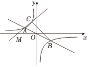

56. （2025•宜宾） 如图，过原点 $O$ 的直线与反比例函数 $y=\frac{k}{x}$（$k\neq 0$）的图象交于 $A$、$B$ 两点．一次函数 $y=mx+b$（$m\neq 0$）的图象过点 $A$ 与反比例函数交于另一点 $C$，与 $x$ 轴交于点 $M$，其中 $A(-2, 1)$，$C(-1, n)$．
（1）求一次函数 $y=mx+b$ 的表达式，并求 $\triangle AOM$ 的面积；
（2）连结 $BC$，在直线 $AC$ 上是否存在点 $D$，使以 $O$、$A$、$D$ 为顶点的三角形与 $\triangle ABC$ 相似．若存在，求出点 $D$ 坐标；若不存在，请说明理由．

> [!question]- 点击查看答案与解析
> 【答案】（1）$y=x+3$，$S_{\triangle AOM}=\frac32$；（2）存在，$D(-\frac32,\frac32)$ 或 $D(3,6)$
> 
> 【考点】待定系数法、中心对称求交点、坐标法求面积、直角三角形相似分类讨论 → [[【初中数学知识点体系-人教版】#27-1 反比例函数]]、[[【初中数学知识点体系-人教版】#23-1 一次函数]]、[[【初中数学知识点体系-人教版】#31-2 相似三角形]]
> 
> 【解析】
> （1）$A(-2,1)$ 在双曲线上，$k=-2$，$y=-\frac2x$，$C(-1,2)$。直线 $AC$ 斜率 $1$，$y=x+3$，令 $y=0$ 得 $M(-3,0)$。$OM=3$，$A$ 到 $x$ 轴距离为 $1$，$S_{\triangle AOM}=\frac12\times3\times1=\frac32$。
> （2）过原点直线与双曲线交于关于原点对称的两点，$B(2,-1)$。$AC=\sqrt2$，$BC=3\sqrt2$，$AB=2\sqrt5$，且 $\overrightarrow{CA}\cdot\overrightarrow{CB}=0$，$\triangle ABC$ 为直角三角形（直角在 $C$），两直角边之比为 $1:3$。
> 设 $D(t,t+3)$ 在直线 $AC$ 上。直角顶点在 $D$：$DO\perp DA$，解得 $t=-\frac32$，$D(-\frac32,\frac32)$，两直角边 $AD=\frac{\sqrt2}{2}$、$OD=\frac{3\sqrt2}{2}$，比为 $1:3$，与 $\triangle ABC$ 相似。
> 直角顶点在 $O$：$OA\perp OD$，解得 $t=3$，$D(3,6)$，两直角边 $OA=\sqrt5$、$OD=3\sqrt5$，比为 $1:3$，亦相似。直角顶点在 $A$ 时 $D$ 与 $A$ 重合，舍去。
> 
> 【易错点】相似未指定对应顶点，要按直角顶点在 $O$、$D$、$A$ 分类；注意利用 $A,B$ 关于原点对称求 $B$，并排除退化情形。
