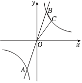

57. （2025•绵阳） 如图，在平面直角坐标系中，正比例函数 $y=mx$（$m\neq 0$）的图象与反比例函数 $y=\frac{k}{x}$（$k\neq 0$）的图象交于 $A(-2, m-9)$，$B$ 两点，点 $C$ 在反比例函数的图象上，且在第一象限内点 $B$ 的右侧，连接 $BC$，$OC$，$\triangle BOC$ 的面积为5．
（1）求点 $A$，$B$ 的坐标及反比例函数的解析式；
（2）探究在 $x$ 轴上是否存在点 $M$，使得以点 $O$，$C$，$M$，$N$ 为顶点的四边形为菱形？若存在，求出点 $N$ 的坐标；若不存在，请说明理由．

> [!question]- 点击查看答案与解析
> 【答案】（1）$A(-2,-6)$，$B(2,6)$，反比例函数 $y=\frac{12}{x}$；（2）存在，$N(8,4)$、$N(-2,4)$、$N(3,-4)$、$N(-\frac76,4)$
> 
> 【考点】待定系数法、中心对称、坐标法求面积、菱形存在性分类讨论 → [[【初中数学知识点体系-人教版】#27-1 反比例函数]]、[[【初中数学知识点体系-人教版】#23-1 一次函数]]、[[【初中数学知识点体系-人教版】#21-2 特殊的平行四边形]]
> 
> 【解析】
> （1）$A(-2,m-9)$ 在 $y=mx$ 上，$m-9=-2m$，$m=3$，$A(-2,-6)$，$k=(-2)\times(-6)=12$。$A,B$ 关于原点对称，$B(2,6)$，$y=\frac{12}{x}$。
> 设 $C(c,\frac{12}{c})$（$c>2$），$S_{\triangle BOC}=\frac12|2\cdot\frac{12}{c}-6c|=5$，解得 $c=3$，$C(3,4)$，$OC=5$。
> （2）设 $M(t,0)$，按 $OC$ 为边或对角线分类。
> ① $OC,OM$ 为邻边：$|OM|=|OC|=5$，$t=\pm5$，$N=C+M$，得 $N(8,4)$ 或 $N(-2,4)$；
> ② $CO,CM$ 为邻边：$|CM|=|CO|=5$，$(t-3)^2+16=25$，$t=6$（$t=0$ 与 $O$ 重合舍去），$N=M-C=(3,-4)$；
> ③ $OC$ 为对角线：$|MO|=|MC|$，$t^2=(t-3)^2+16$，$t=\frac{25}{6}$，$N=O+C-M=(-\frac76,4)$。
> 
> 【易错点】菱形存在性要区分 $OC$ 为边（两种邻边组合）与为对角线；注意舍去 $M$ 与 $O$ 重合的退化情形，第四个顶点坐标按平行四边形对角线互相平分计算。
