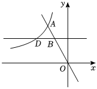

58. （2025•自贡） 如图，正比例函数 $y=kx$ 与反比例函数 $y=-\frac{8}{x}$ 的图象交于点 $A(-2, a)$，点 $B$ 是线段 $OA$ 上异于端点的一点，过点 $B$ 作 $y$ 轴的垂线，交反比例函数的图象于点 $D$．
（1）求 $k$ 的值；
（2）若 $BD=2$，求点 $B$ 坐标；
（3）双曲线 $y=-\frac{8}{x}$ 关于 $y$ 轴对称的图象为 $y'$，直接写出射线 $OA$ 绕点 $O$ 旋转 $90^\circ$ 后与 $y'$ 的交点坐标．

> [!question]- 点击查看答案与解析
> 【答案】（1）$k=-2$；（2）$B(1-\sqrt{5},2\sqrt{5}-2)$；（3）$(4,2)$
> 
> 【考点】待定系数法、线段长度与对称、旋转坐标变换 → [[【初中数学知识点体系-人教版】#27-1 反比例函数]]、[[【初中数学知识点体系-人教版】#23-1 一次函数]]、[[【初中数学知识点体系-人教版】#28-1 图形的旋转]]
> 
> 【解析】
> （1）$A(-2,a)$ 在 $y=\frac{-8}{x}$ 上，$a=4$；代入 $y=kx$ 得 $k=-2$。
> （2）设 $B(t,-2t)$（$-2<t<0$），$D$ 与 $B$ 同纵坐标，在双曲线上 $x_D=\frac{4}{t}$。$BD=t-\frac{4}{t}=2$，解得 $t=1-\sqrt{5}$，$B(1-\sqrt{5},2\sqrt{5}-2)$。
> （3）关于 $y$ 轴对称后的图象为 $y=\frac{8}{x}$。射线 $OA$ 方向向量 $(-2,4)$，旋转 $90^\circ$ 后落在第一象限的方向为 $(4,2)$；其上点 $(4s,2s)$ 满足 $8s^2=8$，$s=1$，交点为 $(4,2)$。
> 
> 【易错点】水平线段长度为横坐标之差的绝对值；关于 $y$ 轴对称时横坐标变号；旋转方向需结合所在象限取舍。
