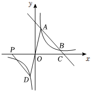

59. （2025•眉山） 如图，一次函数 $y=ax+b$ 与反比例函数 $y=\frac{k}{x}$ 的图象相交于 $A(1, 4)$、$B(4, m)$ 两点，与 $x$ 轴交于点 $C$，点 $D$ 与点 $A$ 关于点 $O$ 对称，连接 $AD$．
（1）求一次函数和反比例函数的解析式；
（2）点 $P$ 在 $x$ 轴的负半轴上，且 $\triangle AOC$ 与 $\triangle POD$ 相似，求点 $P$ 的坐标．

> [!question]- 点击查看答案与解析
> 【答案】（1）反比例函数 $y=\frac{4}{x}$，一次函数 $y=-x+5$；（2）$P(-5,0)$ 或 $P\left(-\frac{17}{5},0\right)$
> 
> 【考点】待定系数法、关于原点对称与相似三角形分类讨论 → [[【初中数学知识点体系-人教版】#27-1 反比例函数]]、[[【初中数学知识点体系-人教版】#23-1 一次函数]]、[[【初中数学知识点体系-人教版】#9-2 坐标方法的简单应用]]
> 
> 【解析】
> （1）$A(1,4)$ 在双曲线上，$k=4$；$B(4,m)$，$m=1$。直线过 $A$、$B$，斜率 $-1$，$y=-x+5$，$C(5,0)$。$D$ 与 $A$ 关于原点对称，$D(-1,-4)$。
> （2）$OA=OD=\sqrt{17}$，$\angle AOC=\angle POD$（正切均为 4）。设 $P(p,0)$，$p<0$。
> 对应 $OA\leftrightarrow OD$、$OC\leftrightarrow OP$：$OP=OC=5$，$P(-5,0)$。
> 交叉对应 $OA\leftrightarrow OP$、$OC\leftrightarrow OD$：$\frac{\sqrt{17}}{-p}=\frac{5}{\sqrt{17}}$，$p=-\frac{17}{5}$，$P\left(-\frac{17}{5},0\right)$。
> 
> 【易错点】相似未指定对应顶点时要考虑两种边长对应；$P$ 在 $x$ 轴负半轴，横坐标取负。
