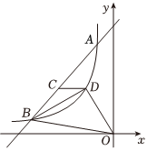

60. （2025•内江） 如图，在平面直角坐标系中，反比例函数 $y=\frac{k_1}{x}$ 的图象与一次函数 $y=k_{2}x+b$ 的图象相交于 $A(a, 6)$、$B(-6, 1)$ 两点．
（1）求反比例函数和一次函数的表达式；
（2）当 $x<0$ 时，请根据函数图象，直接写出关于 $x$ 的不等式 $k_2x+b-\frac{k_1}{x}\geq 0$ 的解集；
（3）过直线 $AB$ 上的点 $C$ 作 $CD\parallel x$ 轴，交反比例函数的图象于点 $D$．若点 $C$ 横坐标为-4，求 $\triangle BOD$ 的面积．

> [!question]- 点击查看答案与解析
> 【答案】（1）反比例函数 $y=-\frac{6}{x}$，一次函数 $y=x+7$；（2）$-6\le x\le -1$；（3）$S_{\triangle BOD}=8$
> 
> 【考点】待定系数法、不等式解集与坐标法求面积 → [[【初中数学知识点体系-人教版】#27-1 反比例函数]]、[[【初中数学知识点体系-人教版】#23-1 一次函数]]、[[【初中数学知识点体系-人教版】#9-2 坐标方法的简单应用]]
> 
> 【解析】
> （1）$B(-6,1)$ 在 $y=\frac{k_1}{x}$ 上，$k_1=-6$。$A(a,6)$：$6=\frac{-6}{a}$，$a=-1$，$A(-1,6)$。直线过 $A$、$B$，斜率 $1$，$y=x+7$。
> （2）$x<0$ 时 $k_2x+b-\frac{k_1}{x}\ge0$（直线在双曲线上方）的解集为 $-6\le x\le -1$。
> （3）$C$ 横坐标 $-4$，$C(-4,3)$。$CD\parallel x$ 轴，$y=3$ 交双曲线于 $D(-2,3)$。
> $S_{\triangle BOD}=\frac{1}{2}|x_B y_D-x_D y_B|=\frac{1}{2}|(-6)\times3-(-2)\times1|=8$。
> 
> 【易错点】水平线上纵坐标相同；面积用行列式，注意 $B$、$D$ 均在第二象限，乘积取绝对值。
