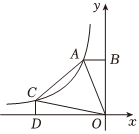

1. （2025•绥化）如图，反比例函数 $y=\frac{k}{x}$ 经过 $A$、$C$ 两点，过点 $A$ 作 $AB\perp y$ 轴于点 $B$，过点 $C$ 作 $CD\perp x$ 轴于点 $D$，连接 $OA$、$OC$、$AC$．若 $S_{\triangle ACO}=4$，$CD:OB=1:3$，则 $k$ 的值是（　　）

A. -12

B. -9

C. -6

D. -3

> [!question]- 点击查看答案与解析
> 【答案】D
> 
> 【考点】反比例函数比例系数 $k$ 的几何意义、坐标法求三角形面积 → [[【初中数学知识点体系-人教版】#27-1 反比例函数]]、坐标方法的简单应用 → [[【初中数学知识点体系-人教版】#9-2 坐标方法的简单应用]]
> 
> 【解析】
> 设 $A(-a,b)$（第二象限），由 $CD:OB=1:3$ 得 $CD=\dfrac{b}{3}$，故 $C\left(-3a,\dfrac{b}{3}\right)$（同一双曲线上 $|x|$ 与 $|y|$ 成反比）。
> 由面积公式 $S_{\triangle ACO}=\dfrac{1}{2}\left|x_Ay_C-x_Cy_A\right|=\dfrac{4ab}{3}=4$，得 $ab=3$。
> 又 $k=(-a)b=-ab=-3$。
> - 选项A：$-12$，与计算结果不符，错误；
> - 选项B：$-9$，与计算结果不符，错误；
> - 选项C：$-6$，与计算结果不符，错误；
> - 选项D：$-3$，正确。
> 
> 【易错点】$k$ 的符号由图象所在象限确定，第二象限分支 $k<0$；三角形面积用坐标行列式割补，勿漏绝对值。
