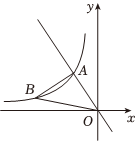

2. （2025•黑龙江）如图，在平面直角坐标系中，点 $A$、点 $B$ 都在双曲线 $y=\frac{k}{x}$（$k\neq 0$）上，且点 $A$ 在点 $B$ 的右侧，点 $A$ 的横坐标为-1，$\angle AOB=\angle ABO=45^\circ$，则 $k$ 的值为（　　）

A. $\sqrt{2}$

B. $-\frac{\sqrt{5}}{2}$

C. $\frac{\sqrt{5}-1}{2}$

D. $-\frac{\sqrt{5}+1}{2}$

> [!question]- 点击查看答案与解析
> 【答案】D
> 
> 【考点】反比例函数上点的坐标特征、等腰直角三角形与坐标旋转 → [[【初中数学知识点体系-人教版】#27-1 反比例函数]]、坐标方法的简单应用 → [[【初中数学知识点体系-人教版】#9-2 坐标方法的简单应用]]
> 
> 【解析】
> $A$ 的横坐标为 $-1$，设 $A(-1,h)$（$h>0$），则 $k=-h$。
> $\angle AOB=\angle ABO=45^\circ$，故 $\angle BAO=90^\circ$ 且 $AO=AB$，即 $AB$ 由 $AO$ 绕 $A$ 顺时针旋转 $90^\circ$ 得到，$B(-1-h,h-1)$。
> $B$ 在双曲线上：$(-1-h)(h-1)=-h$，整理得 $h^2-h-1=0$，取正根 $h=\dfrac{1+\sqrt5}{2}$。
> $k=-h=-\dfrac{\sqrt5+1}{2}$。
> - 选项A：$\sqrt2$，错误；
> - 选项B：$-\dfrac{\sqrt5}{2}$，错误；
> - 选项C：$\dfrac{\sqrt5-1}{2}$，符号与大小均不符，错误；
> - 选项D：$-\dfrac{\sqrt5+1}{2}$，正确。
> 
> 【易错点】先由两个 $45^\circ$ 判定等腰直角三角形，再用坐标旋转求 $B$；注意双曲线第二象限分支 $k<0$。
