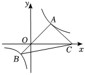

3. （2024•宿迁）如图，点 $A$ 在双曲线 $y_{1}=\frac{k}{x}$（$x>0$）上，连接 $AO$ 并延长，交双曲线 $y_{2}=\frac{k}{4x}$（$x<0$）于点 $B$，点 $C$ 为 $x$ 轴上一点，且 $AO=AC$，连接 $BC$，若 $\triangle ABC$ 的面积是6，则 $k$ 的值为（　　）

A. 2

B. 3

C. 4

D. 5

> [!question]- 点击查看答案与解析
> 【答案】C
> 
> 【考点】反比例函数上点的坐标特征、线段中点与坐标法求面积 → [[【初中数学知识点体系-人教版】#27-1 反比例函数]]、坐标方法的简单应用 → [[【初中数学知识点体系-人教版】#9-2 坐标方法的简单应用]]
> 
> 【解析】
> 设 $A(x_A,y_A)$，$x_Ay_A=k$。$A$、$B$ 关于 $O$ 共线且 $B$ 在 $y_2=\dfrac{k}{4x}$ 上，代入得 $B\left(-\dfrac{x_A}{2},-\dfrac{y_A}{2}\right)$。
> 由 $AO=AC$，$C$ 在 $x$ 轴上，得 $C(2x_A,0)$。
> $S_{\triangle ABC}=\dfrac{3}{2}x_Ay_A=\dfrac{3k}{2}=6$，解得 $k=4$。
> - 选项A：$2$，错误；
> - 选项B：$3$，错误；
> - 选项C：$4$，正确；
> - 选项D：$5$，错误。
> 
> 【易错点】$AO=AC$ 时点 $C$ 是 $O$ 关于直线 $x=x_A$ 的对称点；共线两点在不同双曲线上时，横坐标、纵坐标均成比例。
