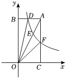

4. （2024•牡丹江）矩形 $OBAC$ 在平面直角坐标系中的位置如图所示，反比例函数 $y=\frac{k}{x}$ 的图象与 $AB$ 边交于点 $D$，与 $AC$ 边交于点 $F$，与 $OA$ 交于点 $E$，$OE=2AE$，若四边形 $ODAF$ 的面积为2，则 $k$ 的值是（　　）

A. $\frac{2}{5}$

B. $\frac{3}{5}$

C. $\frac{4}{5}$

D. $\frac{8}{5}$

> [!question]- 点击查看答案与解析
> 【答案】D
> 
> 【考点】反比例函数 $k$ 的几何意义、矩形坐标与线段比例 → [[【初中数学知识点体系-人教版】#27-1 反比例函数]]、坐标方法的简单应用 → [[【初中数学知识点体系-人教版】#9-2 坐标方法的简单应用]]
> 
> 【解析】
> 设矩形顶点 $A(c,b)$，则 $B(0,b)$、$C(c,0)$。$E$ 在 $OA$ 上且 $OE=2AE$，故 $E\left(\dfrac{2c}{3},\dfrac{2b}{3}\right)$，代入双曲线得 $\dfrac{4bc}{9}=k$，即 $bc=\dfrac{9k}{4}$。
> $D\left(\dfrac{k}{b},b\right)$，$F\left(c,\dfrac{k}{c}\right)$。四边形 $ODAF$ 面积 $=bc-k=2$。
> 代入 $bc=\dfrac{9k}{4}$：$\dfrac{5k}{4}=2$，解得 $k=\dfrac{8}{5}$。
> - 选项A：$\dfrac{2}{5}$，错误；
> - 选项B：$\dfrac{3}{5}$，错误；
> - 选项C：$\dfrac{4}{5}$，错误；
> - 选项D：$\dfrac{8}{5}$，正确。
> 
> 【易错点】对角线 $OA$ 上的分点按比例取坐标；矩形内不规则四边形面积用矩形面积减去周围三角形面积。
