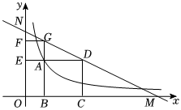

5. （2024•淄博）如图所示，正方形 $ABCD$ 与 $AEFG$（其中边 $BC$，$EF$ 分别在 $x$，$y$ 轴的正半轴上）的公共顶点 $A$ 在反比例函数 $y=\frac{k}{x}$ 的图象上，直线 $DG$ 与 $x$，$y$ 轴分别相交于点 $M$，$N$．若这两个正方形的面积之和是 $\frac{15}{2}$，且 $MD=4GN$．则 $k$ 的值是（　　）

A. 5

B. 1

C. 3

D. 2

> [!question]- 点击查看答案与解析
> 【答案】C
> 
> 【考点】反比例函数与正方形、线段比例及直线截距 → [[【初中数学知识点体系-人教版】#27-1 反比例函数]]、坐标方法的简单应用 → [[【初中数学知识点体系-人教版】#9-2 坐标方法的简单应用]]
> 
> 【解析】
> 设正方形 $ABCD$ 边长为 $p$，正方形 $AEFG$ 边长为 $q$，则 $A(q,p)$，$D(p+q,p)$，$G(q,p+q)$。
> 两正方形面积之和 $p^2+q^2=\dfrac{15}{2}$。直线 $DG$ 方向向量 $(-p,q)$，由 $MD=4GN$ 得 $\dfrac{p^2}{q^2}=4$，即 $p=2q$。
> 代入得 $5q^2=\dfrac{15}{2}$，$q^2=\dfrac{3}{2}$。$k=x_Ay_A=pq=2q^2=3$。
> - 选项A：$5$，错误；
> - 选项B：$1$，错误；
> - 选项C：$3$，正确；
> - 选项D：$2$，错误。
> 
> 【易错点】同一直线上的线段比等于横坐标（或纵坐标）差之比；两个正方形共顶点 $A$，其横、纵坐标分别对应两边长。
