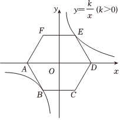

7. （2024•通辽）如图，平面直角坐标系中，原点 $O$ 为正六边形 $ABCDEF$ 的中心，$EF\parallel x$ 轴，点 $E$ 在双曲线 $y=\frac{k}{x}$（$k$ 为常数，$k>0$）上，将正六边形 $ABCDEF$ 向上平移 $\sqrt{3}$ 个单位长度，点 $D$ 恰好落在双曲线上，则 $k$ 的值为（　　）

A. $4\sqrt{3}$

B. $3\sqrt{3}$

C. $2\sqrt{3}$

D. 3

> [!question]- 点击查看答案与解析
> 【答案】A
> 
> 【考点】正六边形坐标特征、平移与反比例函数解析式 → [[【初中数学知识点体系-人教版】#27-1 反比例函数]]、平移 → [[【初中数学知识点体系-人教版】#7-4 平移]]
> 
> 【解析】
> 设正六边形边长为 $s$，中心为 $O$，则 $E\left(\dfrac{s}{2},\dfrac{\sqrt3 s}{2}\right)$，$D(s,0)$。
> $E$ 在 $y=\dfrac{k}{x}$ 上：$k=\dfrac{s}{2}\cdot\dfrac{\sqrt3 s}{2}=\dfrac{\sqrt3 s^2}{4}$。
> 向上平移 $\sqrt3$ 后 $D'(s,\sqrt3)$ 落在双曲线上：$k=s\sqrt3$。联立得 $s=4$，$k=4\sqrt3$。
> - 选项A：$4\sqrt3$，正确；
> - 选项B：$3\sqrt3$，错误；
> - 选项C：$2\sqrt3$，错误；
> - 选项D：$3$，错误。
> 
> 【易错点】正六边形相邻顶点与中心连线夹角 $60^\circ$，坐标按边长分解为 $\left(\dfrac{s}{2},\dfrac{\sqrt3 s}{2}\right)$；平移只改变纵坐标。
