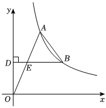

8. （2024•黑龙江）如图，双曲线 $y=\frac{12}{x}$（$x>0$）经过 $A$、$B$ 两点，连接 $OA$、$AB$，过点 $B$ 作 $BD\perp y$ 轴，垂足为 $D$，$BD$ 交 $OA$ 于点 $E$，且 $E$ 为 $AO$ 的中点，则 $\triangle AEB$ 的面积是（　　）

A. 4.5

B. 3.5

C. 3

D. 2.5

> [!question]- 点击查看答案与解析
> 【答案】A
> 
> 【考点】中点坐标、反比例函数 $k$ 的几何意义与面积 → [[【初中数学知识点体系-人教版】#27-1 反比例函数]]、坐标方法的简单应用 → [[【初中数学知识点体系-人教版】#9-2 坐标方法的简单应用]]
> 
> 【解析】
> 设 $A(x_A,y_A)$，$x_Ay_A=12$。$E$ 为 $AO$ 中点，$E\left(\dfrac{x_A}{2},\dfrac{y_A}{2}\right)$。$BD$ 为水平线，故 $y_B=y_E=\dfrac{y_A}{2}$，代入双曲线得 $x_B=2x_A$，即 $B(2x_A,\dfrac{y_A}{2})$。
> $EB=\dfrac{3x_A}{2}$，$A$ 到直线 $EB$ 的高为 $\dfrac{y_A}{2}$，$S_{\triangle AEB}=\dfrac{1}{2}\cdot\dfrac{3x_A}{2}\cdot\dfrac{y_A}{2}=\dfrac{3x_Ay_A}{8}=\dfrac{3\cdot12}{8}=4.5$。
> - 选项A：$4.5$，正确；
> - 选项B：$3.5$，错误；
> - 选项C：$3$，错误；
> - 选项D：$2.5$，错误。
> 
> 【易错点】水平线上各点纵坐标相同；中点坐标为两端点坐标的平均数。
