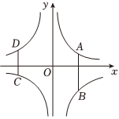

9. （2024•德州）如图，点 $A$，$C$ 在反比例函数 $y=\frac{a}{x}$ 的图象上，点 $B$，$D$ 在反比例函数 $y=\frac{b}{x}$ 的图象上，$AB\parallel CD\parallel y$ 轴，若 $AB=3$，$CD=2$，$AB$ 与 $CD$ 的距离为5，则 $a-b$ 的值为（　　）

A. -2

B. 1

C. 5

D. 6

> [!question]- 点击查看答案与解析
> 【答案】D
> 
> 【考点】反比例函数上点的坐标特征与竖直线段长度 → [[【初中数学知识点体系-人教版】#27-1 反比例函数]]、坐标方法的简单应用 → [[【初中数学知识点体系-人教版】#9-2 坐标方法的简单应用]]
> 
> 【解析】
> 设 $A$、$B$ 所在竖直线 $x=x_1>0$，$C$、$D$ 所在竖直线 $x=x_2<0$。由 $AB=3$ 得 $\dfrac{a-b}{x_1}=3$；由 $CD=2$ 得 $\dfrac{b-a}{x_2}=2$。
> 记 $d=a-b$，则 $x_1=\dfrac{d}{3}$，$x_2=-\dfrac{d}{2}$。两直线距离 $x_1-x_2=\dfrac{5d}{6}=5$，解得 $d=6$，即 $a-b=6$。
> - 选项A：$-2$，错误；
> - 选项B：$1$，错误；
> - 选项C：$5$，错误；
> - 选项D：$6$，正确。
> 
> 【易错点】第二象限内 $b<0$，竖直线段长度为上纵坐标减下纵坐标；两平行线距离为横坐标之差。
