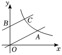

10. （2024•长春）如图，在平面直角坐标系中，点 $O$ 是坐标原点，点 $A$（4，2）在函数 $y=\frac{k}{x}$（$k>0$，$x>0$）的图象上．将直线 $OA$ 沿 $y$ 轴向上平移，平移后的直线与 $y$ 轴交于点 $B$，与函数 $y=\frac{k}{x}$（$k>0$，$x>0$）的图象交于点 $C$．若 $BC=\sqrt{5}$，则点 $B$ 的坐标是（　　）

A. （0，$\sqrt{5}$）

B. （0，3）

C. （0，4）

D. （0，$2\sqrt{5}$）

> [!question]- 点击查看答案与解析
> 【答案】B
> 
> 【考点】一次函数平移、待定系数法与线段长度 → [[【初中数学知识点体系-人教版】#27-1 反比例函数]]、一次函数 → [[【初中数学知识点体系-人教版】#23-1 一次函数]]、坐标方法的简单应用 → [[【初中数学知识点体系-人教版】#9-2 坐标方法的简单应用]]
> 
> 【解析】
> $A(4,2)$ 在双曲线上，$k=8$。直线 $OA$ 为 $y=\dfrac{x}{2}$，向上平移后为 $y=\dfrac{x}{2}+b$，$B(0,b)$。
> $BC=\sqrt5$，直线斜率为 $\dfrac{1}{2}$，水平位移 $\Delta x$ 满足 $|\Delta x|\cdot\dfrac{\sqrt5}{2}=\sqrt5$，故 $\Delta x=2$，$C(2,4)$。
> 代入直线：$4=1+b$，$b=3$，即 $B(0,3)$。
> - 选项A：$(0,\sqrt5)$，错误；
> - 选项B：$(0,3)$，正确；
> - 选项C：$(0,4)$，错误；
> - 选项D：$(0,2\sqrt5)$，错误。
> 
> 【易错点】沿 $y$ 轴平移直线不改变斜率；斜线段长度由水平（或竖直）位移除以方向余弦得到。
