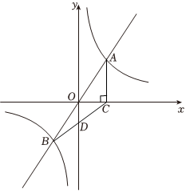

11. （2024•新疆）如图，在平面直角坐标系中，直线 $y=kx$（$k>0$）与双曲线 $y=\frac{2}{x}$ 交于 $A$，$B$ 两点，$AC\perp x$ 轴于点 $C$，连接 $BC$ 交 $y$ 轴于点 $D$，结合图象判断下列结论：$①$ 点 $A$ 与点 $B$ 关于原点对称；$②$ 点 $D$ 是 $BC$ 的中点；$③$ 在 $y=\frac{2}{x}$ 的图象上任取点 $P$（$x_{1}$，$y_{1}$）和点 $Q$（$x_{2}$，$y_{2}$），如果 $y_{1}>y_{2}$，那么 $x_{1}>x_{2}$；$④$ $S_{\triangle BOD}=\frac{1}{2}$．其中正确结论的个数是（　　）

A. 1

B. 2

C. 3

D. 4

> [!question]- 点击查看答案与解析
> 【答案】C
> 
> 【考点】中心对称、中点坐标与反比例函数 $k$ 的几何意义 → [[【初中数学知识点体系-人教版】#27-1 反比例函数]]、坐标方法的简单应用 → [[【初中数学知识点体系-人教版】#9-2 坐标方法的简单应用]]
> 
> 【解析】
> ① 过原点的直线与 $y=\dfrac{2}{x}$ 的两个交点关于原点对称，正确。
> ② 设 $A(x_A,y_A)$，则 $B(-x_A,-y_A)$，$C(x_A,0)$。$BC$ 中点为 $\left(0,-\dfrac{y_A}{2}\right)$，在 $y$ 轴上，即 $D$ 是 $BC$ 中点，正确。
> ③ 反比例函数在每个分支上 $y$ 随 $x$ 增大而减小，跨分支时不成立，错误。
> ④ $S_{\triangle BOD}=\dfrac{1}{2}\cdot OD\cdot|x_B|=\dfrac{x_Ay_A}{4}=\dfrac{2}{4}=\dfrac{1}{2}$，正确。
> 综上，正确结论为①②④，共 $3$ 个。
> - 选项A：$1$，错误；
> - 选项B：$2$，错误；
> - 选项C：$3$，正确；
> - 选项D：$4$，错误。
> 
> 【易错点】逐一判断结论时注意增减性仅限同一分支；三角形面积以坐标轴上的线段为底。
