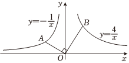

12. （2024•苏州）如图，点 $A$ 为反比例函数 $y=-\frac{1}{x}$（$x<0$）图象上的一点，连接 $AO$，过点 $O$ 作 $OA$ 的垂线与反比例函数 $y=\frac{4}{x}$（$x>0$）的图象交于点 $B$，则 $\frac{AO}{BO}$ 的值为（　　）

A. $\frac{1}{2}$

B. $\frac{1}{4}$

C. $\frac{\sqrt{3}}{3}$

D. $\frac{1}{3}$

> [!question]- 点击查看答案与解析
> 【答案】A
> 
> 【考点】两直线垂直的坐标表示与反比例函数上点的坐标 → [[【初中数学知识点体系-人教版】#27-1 反比例函数]]、坐标方法的简单应用 → [[【初中数学知识点体系-人教版】#9-2 坐标方法的简单应用]]
> 
> 【解析】
> 设 $A(x_A,y_A)$，$x_A<0$，$y_A=-\dfrac{1}{x_A}$；$B(x_B,y_B)$，$x_B>0$，$y_B=\dfrac{4}{x_B}$。
> $OA\perp OB$：$x_Ax_B+y_Ay_B=0$，代入得 $(x_Ax_B)^2=4$，又 $x_Ax_B<0$，故 $x_Ax_B=-2$，$y_B=-2x_A$。
> $BO^2=x_B^2+y_B^2=\dfrac{4}{x_A^2}+4x_A^2=4\left(x_A^2+\dfrac{1}{x_A^2}\right)=4AO^2$，故 $\dfrac{AO}{BO}=\dfrac{1}{2}$。
> - 选项A：$\dfrac{1}{2}$，正确；
> - 选项B：$\dfrac{1}{4}$，错误；
> - 选项C：$\dfrac{\sqrt3}{3}$，错误；
> - 选项D：$\dfrac{1}{3}$，错误。
> 
> 【易错点】两向量垂直时点积为零；利用双曲线解析式把纵坐标用横坐标代换后再化简。
