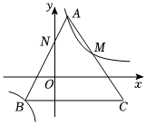

13. （2024•宜宾）如图，等腰三角形 $ABC$ 中，$AB=AC$，反比例函数 $y=\frac{k}{x}$（$k\neq 0$）的图象经过点 $A$、$B$ 及 $AC$ 的中点 $M$，$BC\parallel x$ 轴，$AB$ 与 $y$ 轴交于点 $N$．则 $\frac{AN}{AB}$ 的值为（　　）

A. $\frac{1}{3}$

B. $\frac{1}{4}$

C. $\frac{1}{5}$

D. $\frac{2}{5}$

> [!question]- 点击查看答案与解析
> 【答案】B
> 
> 【考点】等腰三角形坐标、中点与线段比例 → [[【初中数学知识点体系-人教版】#27-1 反比例函数]]、坐标方法的简单应用 → [[【初中数学知识点体系-人教版】#9-2 坐标方法的简单应用]]
> 
> 【解析】
> 设 $A(u,v)$，$B(b,w)$，$C(2u-b,w)$，$M$ 为 $AC$ 中点。由 $uv=bw=k$ 及 $M$ 在双曲线上，推得 $v=-3w$、$b=-3u$。
> 直线 $AB$ 与 $y$ 轴交于 $N$，由横坐标 $b=-3u$ 到 $u$ 的分点关系，$N$ 位于 $B$ 到 $A$ 的 $\dfrac{3}{4}$ 处，故 $\dfrac{AN}{AB}=\dfrac{1}{4}$。
> - 选项A：$\dfrac{1}{3}$，错误；
> - 选项B：$\dfrac{1}{4}$，正确；
> - 选项C：$\dfrac{1}{5}$，错误；
> - 选项D：$\dfrac{2}{5}$，错误。
> 
> 【易错点】等腰三角形底边水平时，顶点在底边的垂直平分线上；求线段比时用横坐标分点比例，不必求出具体坐标。
