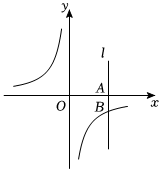

14. （2024•镇江）如图，在平面直角坐标系中，过点 $A$（$m$，0）且垂直于 $x$ 轴的直线 $l$ 与反比例函数 $y=-\frac{4}{x}$ 的图象交于点 $B$，将直线 $l$ 绕点 $B$ 逆时针旋转 $45^\circ$，所得的直线经过第一、二、四象限，则 $m$ 的取值范围是（　　）

A. $m<-2$ 或 $m>2$

B. $-2<m<2$ 且 $m\neq 0$

C. $-2<m<0$ 或 $m>2$

D. $m<-2$ 或 $0<m<2$

> [!question]- 点击查看答案与解析
> 【答案】C
> 
> 【考点】一次函数旋转、图象所过象限与不等式 → [[【初中数学知识点体系-人教版】#23-1 一次函数]]、坐标方法的简单应用 → [[【初中数学知识点体系-人教版】#9-2 坐标方法的简单应用]]
> 
> 【解析】
> $B\left(m,-\dfrac{4}{m}\right)$。竖直线 $l$ 绕 $B$ 逆时针旋转 $45^\circ$ 后斜率为 $-1$，直线为 $y=-x+m-\dfrac{4}{m}$。
> 直线经过第一、二、四象限，需 $y$ 轴截距 $m-\dfrac{4}{m}>0$，即 $\dfrac{m^2-4}{m}>0$，解得 $m>2$ 或 $-2<m<0$。
> - 选项A：$m<-2$ 或 $m>2$，错误；
> - 选项B：$-2<m<2$ 且 $m\neq0$，错误；
> - 选项C：$-2<m<0$ 或 $m>2$，正确；
> - 选项D：$m<-2$ 或 $0<m<2$，错误。
> 
> 【易错点】竖直直线旋转 $45^\circ$ 后斜率为 $\pm1$，方向由旋转方向确定；直线过二、四象限的前提是截距为正、斜率为负。
