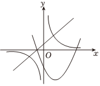

15. （2024•自贡）一次函数 $y=x-2n+4$，二次函数 $y=x^{2}+$（$n-1$）$x-3$，反比例函数 $y=\frac{n+1}{x}$ 在同一平面直角坐标系中图象如图所示，则 $n$ 的取值范围是（　　）

A. $n>-1$

B. $n>2$

C. $-1<n<1$

D. $1<n<2$

> [!question]- 点击查看答案与解析
> 【答案】C
> 
> 【考点】一次函数、二次函数与反比例函数的图象与性质 → [[【初中数学知识点体系-人教版】#27-1 反比例函数]]、一次函数 → [[【初中数学知识点体系-人教版】#23-1 一次函数]]、二次函数的图象与性质 → [[【初中数学知识点体系-人教版】#26-1 二次函数的图象与性质]]
> 
> 【解析】
> 双曲线位于一、三象限，$n+1>0$，即 $n>-1$。
> 直线 $y=x-2n+4$ 的 $y$ 轴截距 $-2n+4>0$，得 $n<2$；抛物线对称轴 $x=\dfrac{1-n}{2}$ 在 $y$ 轴右侧，得 $n<1$。
> 综上 $-1<n<1$。
> - 选项A：$n>-1$，未排除 $n\geq1$，错误；
> - 选项B：$n>2$，错误；
> - 选项C：$-1<n<1$，正确；
> - 选项D：$1<n<2$，错误。
> 
> 【易错点】由图象位置分别判断各函数系数符号，再取公共范围；二次函数对称轴位置由一次项系数符号决定。
