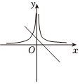
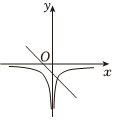
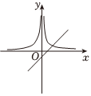
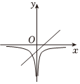

16. （2024•大庆）在同一平面直角坐标系中，函数 $y=kx-k$（$k\neq 0$）与 $y=\frac{k}{|x|}$ 的大致图象为（　　）

A. 

B. 

C. 

D. 

> [!question]- 点击查看答案与解析
> 【答案】C
> 
> 【考点】含绝对值的反比例函数与一次函数图象判断 → [[【初中数学知识点体系-人教版】#27-1 反比例函数]]、一次函数 → [[【初中数学知识点体系-人教版】#23-1 一次函数]]
> 
> 【解析】
> $y=\dfrac{k}{|x|}$ 的两支同在 $x$ 轴上方（$k>0$）或同在下方（$k<0$），且关于 $y$ 轴对称。
> 直线 $y=kx-k=k(x-1)$ 恒过 $(1,0)$：$k>0$ 时直线上升、$y$ 轴截距 $-k<0$；$k<0$ 时直线下降、截距 $-k>0$。
> 选项中只有 C 满足：双曲线关于 $y$ 轴对称且位于 $x$ 轴上方，直线上升并交 $y$ 轴于负半轴，与 $k>0$ 一致。
> 
> 【易错点】先按 $k$ 的符号分组判断两类图象是否自洽，再排除不对称、直线方向矛盾的选项。
