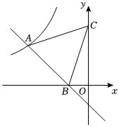

18. （2025•齐齐哈尔）如图，在平面直角坐标系中，一次函数 $y=-x-1$ 的图象与反比例函数 $y=\frac{k}{x}$（$k\neq 0$）的图象在第二象限内交于点 $A$，与 $x$ 轴交于点 $B$，点 $C$ 坐标为（0，3），连接 $AC$，$BC$，若 $AC=BC$，则实数 $k$ 的值为 ___ ．

> [!question]- 点击查看答案与解析
> 【答案】$-6$
> 
> 【考点】待定系数法、等距点坐标与反比例函数 → [[【初中数学知识点体系-人教版】#27-1 反比例函数]]、坐标方法的简单应用 → [[【初中数学知识点体系-人教版】#9-2 坐标方法的简单应用]]
> 
> 【解析】
> 直线 $y=-x-1$ 交 $x$ 轴于 $B(-1,0)$，又 $C(0,3)$，$BC^2=10$。
> 设 $A(x,-x-1)$，由 $AC=BC$：$x^2+(-x-4)^2=10$，解得 $x=-1$（与 $B$ 重合，舍去）或 $x=-3$，故 $A(-3,2)$。
> $k=x_Ay_A=-3\times2=-6$。
> 
> 【易错点】$AC=BC$ 是 $A$ 到 $C$ 与 $B$ 到 $C$ 等距，不要误作 $AB=AC$；注意舍去与 $B$ 重合的解。
