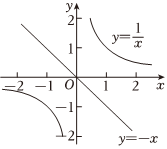

19. （2025•山东）如图，取直线 $y=-x$ 上一点 $A_{1}$（$x_{1}$，$y_{1}$），$①$ 过点 $A_{1}$ 作 $x$ 轴的垂线，交 $y=\frac{1}{x}$ 于点 $A_{2}$（$x_{2}$，$y_{2}$）；$②$ 过点 $A_{2}$ 作 $y$ 轴的垂线，交 $y=-x$ 于点 $A_{3}$（$x_{3}$，$y_{3}$）；如此循环进行下去．按照上面的操作，若点 $A_{1}$ 的坐标为（1，-1），则点 $A_{2025}$ 的坐标是 ___ ．

> [!question]- 点击查看答案与解析
> 【答案】$(1,-1)$
> 
> 【考点】反比例函数与一次函数交点、坐标循环规律 → [[【初中数学知识点体系-人教版】#27-1 反比例函数]]、一次函数 → [[【初中数学知识点体系-人教版】#23-1 一次函数]]
> 
> 【解析】
> $A_1(1,-1)$；作竖直线交 $y=\dfrac{1}{x}$ 得 $A_2(1,1)$；作水平线交 $y=-x$ 得 $A_3(-1,1)$；继续得 $A_4(-1,-1)$，$A_5=A_1$，周期为 $4$。
> $2025=4\times506+1$，故 $A_{2025}=A_1=(1,-1)$。
> 
> 【易错点】按操作顺序交替作竖直线、水平线；周期从 $A_1$ 开始计数，余数为 $1$ 对应 $A_1$。
