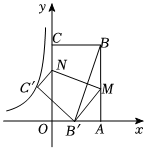

20. （2024•日照）如图，在平面直角坐标系 $xOy$ 中，点 $A$（4，0），$C$（0，$4\sqrt{2}$）是矩形 $OABC$ 的顶点，点 $M$，$N$ 分别为边 $AB$，$OC$ 上的点，将矩形 $OABC$ 沿直线 $MN$ 折叠，使点 $B$ 的对应点 $B'$ 在边 $OA$ 的中点处，点 $C$ 的对应点 $C′$ 在反比例函数 $y=\frac{k}{x}$（$k\neq 0$）的图象上，则 $k=$ ___ ．

> [!question]- 点击查看答案与解析
> 【答案】$-\dfrac{160\sqrt2}{81}$
> 
> 【考点】折叠的坐标变换、矩形与反比例函数 → [[【初中数学知识点体系-人教版】#15-1 图形的轴对称]]、反比例函数 → [[【初中数学知识点体系-人教版】#27-1 反比例函数]]、坐标方法的简单应用 → [[【初中数学知识点体系-人教版】#9-2 坐标方法的简单应用]]
> 
> 【解析】
> $B(4,4\sqrt2)$，$B'$ 为 $OA$ 中点 $(2,0)$。设 $M(4,m)$，由 $MB=MB'$：$(4\sqrt2-m)^2=4+m^2$，解得 $m=\dfrac{7\sqrt2}{4}$。
> $MN$ 是 $BB'$ 的垂直平分线，斜率为 $-\dfrac{\sqrt2}{4}$，得 $N\left(0,\dfrac{11\sqrt2}{4}\right)$。
> 折痕直线 $\sqrt2x+4y-11\sqrt2=0$，反射 $C(0,4\sqrt2)$ 得 $C'\left(-\dfrac{10}{9},\dfrac{16\sqrt2}{9}\right)$，故 $k=x_{C'}y_{C'}=-\dfrac{160\sqrt2}{81}$。
> 
> 【易错点】折叠前后对应点连线被折痕垂直平分；用点关于直线的反射公式时注意横、纵坐标修正项的符号。
