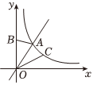

22. （2024•广元）已知 $y=\sqrt{3}x$ 与 $y=\frac{k}{x}$（$x>0$）的图象交于点 $A$（2，$m$），点 $B$ 为 $y$ 轴上一点，将 $\triangle OAB$ 沿 $OA$ 翻折，使点 $B$ 恰好落在 $y=\frac{k}{x}$（$x>0$）上点 $C$ 处，则 $B$ 点坐标为 ___ ．

> [!question]- 点击查看答案与解析
> 【答案】$(0,4)$
> 
> 【考点】翻折的坐标变换、待定系数法求反比例解析式 → [[【初中数学知识点体系-人教版】#15-1 图形的轴对称]]、反比例函数 → [[【初中数学知识点体系-人教版】#27-1 反比例函数]]、坐标方法的简单应用 → [[【初中数学知识点体系-人教版】#9-2 坐标方法的简单应用]]
> 
> 【解析】
> $A(2,m)$ 在 $y=\sqrt3x$ 上，$m=2\sqrt3$，$k=2\times2\sqrt3=4\sqrt3$。
> 直线 $OA$ 倾角为 $60^\circ$，$B(0,b)$ 关于 $OA$ 的对称点 $C$ 落在倾角 $30^\circ$ 的射线上，$C\left(\dfrac{b\sqrt3}{2},\dfrac{b}{2}\right)$。
> 代入双曲线：$\dfrac{b\sqrt3}{2}\cdot\dfrac{b}{2}=4\sqrt3$，$b^2=16$，取 $b=4$，即 $B(0,4)$。
> 
> 【易错点】翻折前后 $OB=OC$；对称点所在射线由两倍角关系确定，注意 $b$ 取正值。
