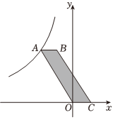

23. （2024•齐齐哈尔）如图，反比例函数 $y=\frac{k}{x}$（$x<0$）的图象经过平行四边形 $ABCO$ 的顶点 $A$，$OC$ 在 $x$ 轴上，若点 $B$（-1，3），$S_{\text{▱}ABCD}=3$，则实数 $k$ 的值为 ___ ．

> [!question]- 点击查看答案与解析
> 【答案】$-6$
> 
> 【考点】平行四边形顶点坐标特征与反比例函数 → [[【初中数学知识点体系-人教版】#21-1 平行四边形]]、反比例函数 → [[【初中数学知识点体系-人教版】#27-1 反比例函数]]
> 
> 【解析】
> 平行四边形 $ABCO$ 中 $A+C=B+O$。面积 $=OC\times3=3$，故 $OC=1$，$C(1,0)$。
> $A=B-C=(-2,3)$，$k=x_Ay_A=-2\times3=-6$。
> 
> 【易错点】平行四边形对角顶点的坐标和相等；本题高为点 $B$ 的纵坐标 $3$。
