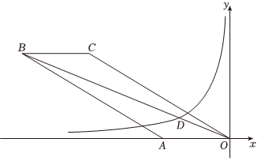

24. （2024•绥化）如图，已知点 $A$（-7，0），$B$（$x$，10），$C$（-17，$y$），在平行四边形 $ABCO$ 中，它的对角线 $OB$ 与反比例函数 $y=\frac{k}{x}$（$k\neq 0$）的图象相交于点 $D$，且 $OD:OB=1:4$，则 $k=$ ___ ．

> [!question]- 点击查看答案与解析
> 【答案】$-15$
> 
> 【考点】平行四边形顶点坐标、线段比例与反比例函数 → [[【初中数学知识点体系-人教版】#21-1 平行四边形]]、反比例函数 → [[【初中数学知识点体系-人教版】#27-1 反比例函数]]、坐标方法的简单应用 → [[【初中数学知识点体系-人教版】#9-2 坐标方法的简单应用]]
> 
> 【解析】
> 由平行四边形对角线互相平分，$A+C=B+O$，故 $B=A+C=(-24,y)$；由 $B$ 的纵坐标为 $10$ 得 $y=10$，$B(-24,10)$。
> $OD:OB=1:4$，$D=\dfrac{1}{4}B=\left(-6,\dfrac{5}{2}\right)$，$k=-6\times\dfrac{5}{2}=-15$。
> 
> 【易错点】对角线 $OB$ 上的分点坐标按比例缩小；平行四边形顶点顺序为 $A$、$B$、$C$、$O$。
