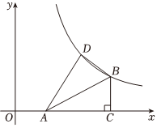

25. （2024•扬州）如图，在平面直角坐标系中，点 $A$ 的坐标为（1，0），点 $B$ 在反比例函数 $y=\frac{k}{x}$（$x>0$）的图象上，$BC\perp x$ 轴于点 $C$，$\angle BAC=30^\circ$，将 $\triangle ABC$ 沿 $AB$ 翻折，若点 $C$ 的对应点 $D$ 落在该反比例函数的图象上，则 $k$ 的值为 ___ ．

> [!question]- 点击查看答案与解析
> 【答案】$2\sqrt3$
> 
> 【考点】轴对称翻折、点关于直线的反射与反比例函数 → [[【初中数学知识点体系-人教版】#15-1 图形的轴对称]]、反比例函数 → [[【初中数学知识点体系-人教版】#27-1 反比例函数]]、坐标方法的简单应用 → [[【初中数学知识点体系-人教版】#9-2 坐标方法的简单应用]]
> 
> 【解析】
> 设 $B(x,y)$，$C(x,0)$。$\angle BAC=30^\circ$，故 $y=\dfrac{x-1}{\sqrt3}$。
> $C$ 关于直线 $AB$（倾角 $30^\circ$）的对称点 $D\left(\dfrac{x+1}{2},\dfrac{(x-1)\sqrt3}{2}\right)$。
> $B$、$D$ 均在双曲线上：$\dfrac{x(x-1)}{\sqrt3}=\dfrac{\sqrt3(x^2-1)}{4}$，解得 $x=3$，$y=\dfrac{2\sqrt3}{3}$，$k=2\sqrt3$。
> 
> 【易错点】反射点坐标由投影公式求得；翻折前后对应线段、对应角相等。
