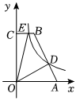

26. （2024•内蒙古）如图，在平面直角坐标系中，点 $A$，$B$ 的坐标分别为（5，0），（2，6），过点 $B$ 作 $BC\parallel x$ 轴交 $y$ 轴于点 $C$，点 $D$ 为线段 $AB$ 上的一点，且 $BD=2AD$，反比例函数 $y=\frac{k}{x}$（$x>0$）的图象经过点 $D$ 交线段 $BC$ 于点 $E$，则四边形 $ODBE$ 的面积是 ___ ．

> [!question]- 点击查看答案与解析
> 【答案】$12$
> 
> 【考点】线段定比分点、坐标法求四边形面积 → [[【初中数学知识点体系-人教版】#27-1 反比例函数]]、坐标方法的简单应用 → [[【初中数学知识点体系-人教版】#9-2 坐标方法的简单应用]]
> 
> 【解析】
> $D$ 分 $AB$ 为 $AD:DB=1:2$，$D=\left(\dfrac{2A+B}{3}\right)=(4,2)$，$k=8$。
> $E$ 在 $BC$（直线 $y=6$）上，$E=\left(\dfrac{4}{3},6\right)$。
> 由鞋带公式 $S_{ODBE}=12$。
> 
> 【易错点】定比分点坐标按比例加权；四边形面积可用鞋带公式或矩形、三角形割补。
